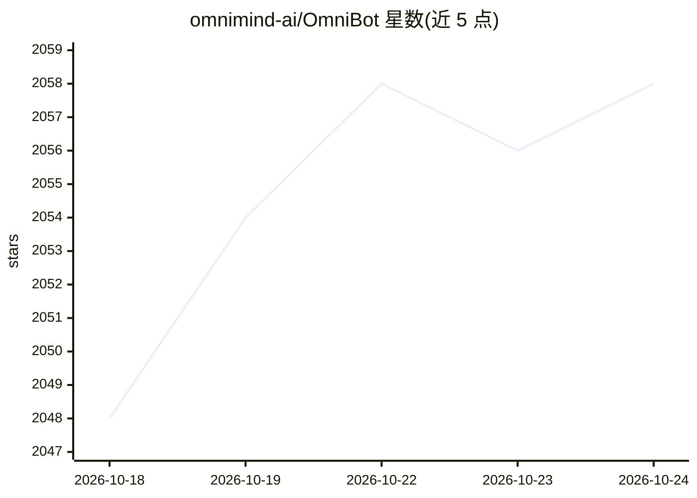

# omnimind-ai/OmniBot

⭐ 2,058 · Kotlin · NOASSERTION · 推送 2026-10-24 · [GitHub](https://github.com/omnimind-ai/OmniBot) · [官网](https://omnibot.omnimind.com.cn) · 组织维护 · 中文 README

**运行在 Android 设备上的本地 AI 代理应用：聊天加系统级任务执行**

用原生 Kotlin 与 Flutter 构建的 Android 端 AI 代理应用，围绕理解→决策→执行→反思循环工作。功能包括技能生态、内置 Alpine 环境、浏览器、终端与文件工作区、MCP、定时任务与闹钟日历、无 root 的个人上下文查询（日历/联系人/通知/短信/通话记录）、带嵌入的短期长期记忆。模型由用户在设置中配置 AI 提供商，记忆嵌入需配 embedding 模型；另提供连接 PC/Mac 上 Codex CLI 的 codex-bridge 通道与独立 React WebUI。开发构建需 Flutter 3.47.2+、JDK 17+。

## 筛选速览

| 维度 | 判定 | 备注 |
|---|---|---|
| AI 角色 | `ai-native` | 本体是模型或模型工具 |
| 许可风险 | `none` | NOASSERTION |
| 部署形态 | `library` | 以包/库形式分发 |
| 模型依赖 | — | README 未给出锁定关系 |
| 硬件要求 | — | 无带数字的原话,不猜 |
| 安装摩擦 | `low` | 无编译、无系统依赖或容器化 |
| 成熟度 | — | 结构信号不足 |

## 能力要点

- 内置 Alpine 环境、终端、浏览器与文件工作区
- 无 root/Shizuku/无障碍访问日历、联系人、通知、短信等个人上下文
- 技能仓库：发送仓库链接即可安装技能
- 短期/长期记忆系统，嵌入检索需 embedding 模型
- codex-bridge 远程连接 PC/Mac 上的 Codex CLI

## 适用场景

- 在手机上让 AI 代理操作终端、浏览器和文件完成完整任务
- 通过授权让 AI 查询日历、通知等个人上下文并管理日程联系人
- 设置定时子代理任务与提醒

## 场景标签

`AI 助手` `浏览器自动化` `GUI 自动化` · 领域:效率与自动化

## 证据(README 行号)

> L23: > OmniBot runs directly on your Android device and combines chat, agent tools, local workspaces, and system integra
> L26: OmniBot is an on-device AI agent built with native Android Kotlin and Flutter. Instead of stopping at chat, it focu
> L30: - **Extensible tool ecosystem**: Skills, Alpine environment, browser access, MCP, and Android system-level tools.

## 星数曲线

2026-10-18 2,048 → 2026-10-24 2,058（+10）

---
*卡片 v1 · prompt 1.4 · 生成 2026-10-21 · 置信度 mid · 依据 README sha `6d0a8e9a622d` · [字段定义](../../DATASET.md)*
