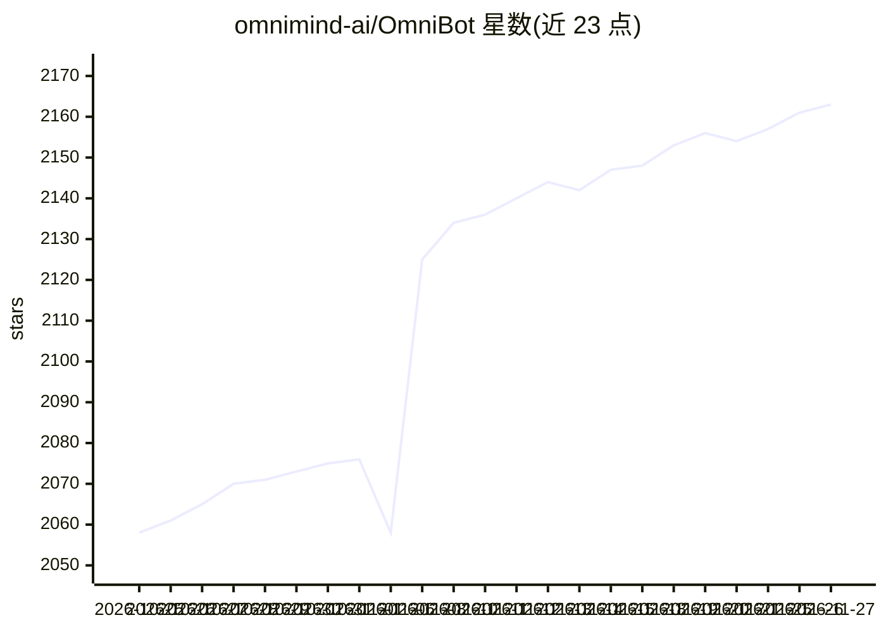

# omnimind-ai/OmniBot

⭐ 2,163 · Dart · NOASSERTION · 推送 2026-11-22 · [GitHub](https://github.com/omnimind-ai/OmniBot) · [官网](https://omnibot.omnimind.com.cn) · 组织维护 · 中文 README

**安卓端侧 AI Agent 应用：操作终端并完成 Android 设备任务**

基于 Android Kotlin 与 Flutter 构建的端侧 AI 助手应用，围绕理解-决策-执行-反思闭环工作。提供可扩展工具生态（Skills、Alpine 环境、浏览器、MCP、Android 系统级工具），可免 root 查询日历、联系人、通知、短信等个人上下文，支持定时子代理任务、记忆系统（含嵌入）、Root/Shizuku 可选控制、技能商店与远程 Codex 桥接。开发需 Flutter SDK、JDK 17+ 与 Node.js/pnpm，从源码构建 APK。

## 筛选速览

| 维度 | 判定 | 备注 |
|---|---|---|
| AI 角色 | `ai-native` | 本体是模型或模型工具 |
| 许可风险 | `none` | NOASSERTION |
| 部署形态 | `library` | 以包/库形式分发 |
| 模型依赖 | — | README 未给出锁定关系 |
| 硬件要求 | — | 无带数字的原话,不猜 |
| 安装摩擦 | `low` | 无编译、无系统依赖或容器化 |
| 成熟度 | — | 结构信号不足 |

## 能力要点

- 操作终端与 Android 系统级动作（定时任务、闹钟、日历、音频控制）
- 免 root 读取日历/联系人/通知/短信/通话记录等个人上下文
- 技能商店：发送仓库链接即可安装技能，支持 MCP
- 远程 Codex 桥接：扫码连接 PC/Mac 上的 Codex CLI

## 适用场景

- 在手机上让 AI 代理执行终端命令和自动化任务
- 通过自然语言查询和管理日历、联系人、通知
- 定时运行子代理完成完整任务流程
- 连接桌面端 Codex 进行远程协作

## 场景标签

`AI 助手` `GUI 自动化` `浏览器自动化` · 领域:效率与自动化

## 证据(README 行号)

> L23: > OmniBot runs directly on your Android device and combines chat, agent tools, local workspaces, and system integra
> L26: OmniBot is an on-device AI agent built with native Android Kotlin and Flutter. Instead of stopping at chat, it focu
> L32: - **Personal context**: Query authorized calendars, contacts, notifications, app usage, location, media, documents,

## 星数曲线

2026-10-25 2,058 → 2026-11-27 2,163（+105）

---
*卡片 v1 · prompt 1.4 · 生成 2026-11-23 · 置信度 high · 依据 README sha `6b74bf603461` · [字段定义](../../DATASET.md)*
