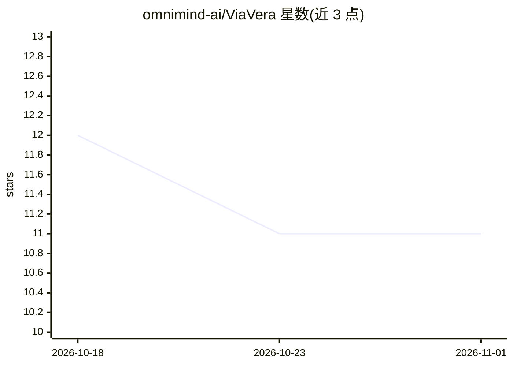

# omnimind-ai/ViaVera

⭐ 11 · Swift · GPL-3.0 · 推送 2026-10-18 · [GitHub](https://github.com/omnimind-ai/ViaVera) · [官网](https://testflight.apple.com/join/YMwpPFRP) · 组织维护 · 中文 README

**iOS/macOS 本地运行的原生 AI 代理应用，可操作终端**

SwiftUI 编写的 Apple 平台（iPhone/ipad/Mac）原生 AI 代理应用，实现理解→决策→执行→反思的完整循环。内嵌 ARM64 Alpine Linux 运行时（ish-arm64），提供终端、文件、记忆、技能、浏览器、日历/联系人/HealthKit 等工具，模型服务由用户自选（OpenAI 兼容、DeepSeek、Anthropic）。API 密钥存 Keychain，凭据与配置保持主机侧控制。开发需 Apple Silicon Mac 与 Xcode，通过源码构建，另有 TestFlight 预览渠道。

## 筛选速览

| 维度 | 判定 | 备注 |
|---|---|---|
| AI 角色 | `ai-native` | 本体是模型或模型工具 |
| 许可风险 | `viral` | GPL-3.0 |
| 部署形态 | `None` |  |
| 模型依赖 | locked-api |  |
| 硬件要求 | — | 无带数字的原话,不猜 |
| 安装摩擦 | `medium` | 含编译或系统依赖之一 |
| 成熟度 | — | 结构信号不足 |

## 能力要点

- 内嵌 ARM64 Alpine Linux 环境（ish-arm64）与受控 /workspace 挂载
- 支持 OpenAI 兼容、DeepSeek、Anthropic Messages 等模型提供方
- 终端/文件/浏览器/日历/联系人/HealthKit 等可扩展代理工具
- SwiftData 对话、每日记忆与长期 Markdown 记忆，密钥存 Keychain

## 适用场景

- 在 Mac 或 iPhone 上让 AI 代理执行终端命令与管理文件
- 导入 SKILL.md 技能包扩展代理能力
- 通过浏览器与个人数据工具完成自动化工作流

## 场景标签

`AI 助手` · 领域:对话与助手

## 证据(README 行号)

> L23:  Community
> L27: Built with SwiftUI, Via Vera goes beyond chat by completing the full loop of **understand → decide → execute → refl

## 星数曲线

2026-10-18 12 → 2026-11-01 11（-1）

---
*卡片 v1 · prompt 1.4 · 生成 2026-11-01 · 置信度 high · 依据 README sha `a6d9477f8091` · [字段定义](../../DATASET.md)*
