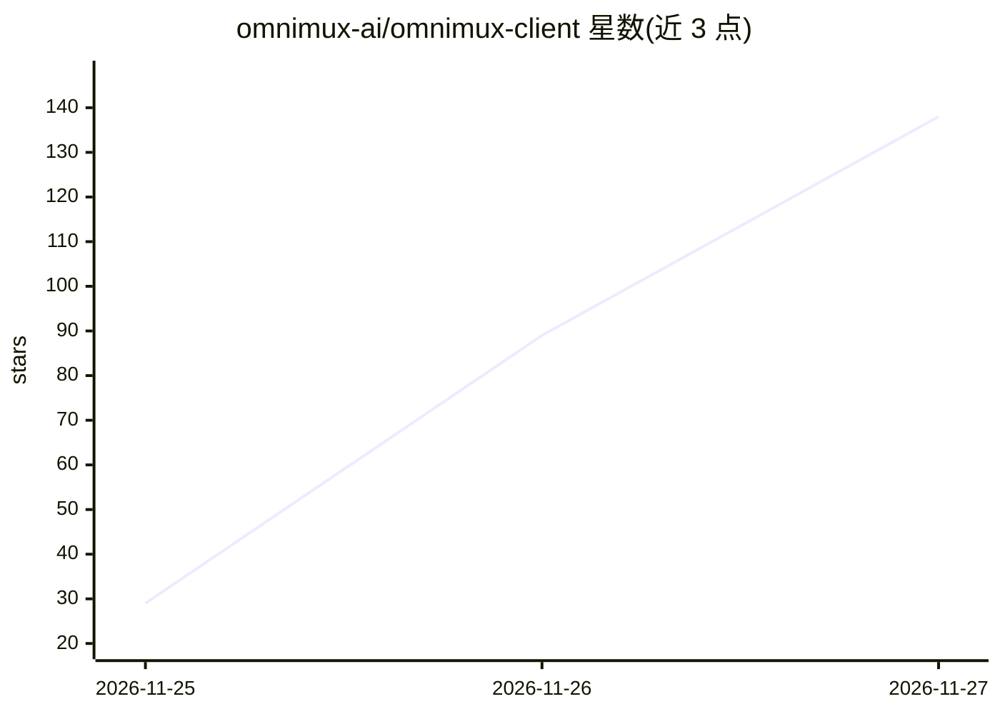

# omnimux-ai/omnimux-client

⭐ 138 · JavaScript · AGPL-3.0 · 推送 2026-11-26 · [GitHub](https://github.com/omnimux-ai/omnimux-client) · [官网](https://omnimux.ai) · 组织维护 · 中文 README

**本地 AI 商品视频工作台：营销视频与带货内容一站式生成剪辑**

面向电商营销与 UGC 创作者的本地优先桌面应用（Electron，macOS/Windows 安装包），基于 DeepSeek Harness 运行时。内置商品库（粘贴落地页提取卖点）、6,380+ 云端素材（数字人、场景、道具、钩子、风格、音频）、灵感拆解（Chrome 扩展采集）、DAG 多模态画布与多轨时间线，人与 Agent 共同编辑同一工作区，本地导出 MP4；数据存于 ~/.omnimux，支持 BYOK 自带 API key。

## 筛选速览

| 维度 | 判定 | 备注 |
|---|---|---|
| AI 角色 | `ai-native` | 本体是模型或模型工具 |
| 许可风险 | `dual` | AGPL-3.0 |
| 部署形态 | `desktop` | 安装包/桌面程序 |
| 模型依赖 | locked-api |  |
| 硬件要求 | — | 无带数字的原话,不猜 |
| 安装摩擦 | `low` | 无编译、无系统依赖或容器化 |
| 成熟度 | — | 结构信号不足 |

## 能力要点

- 内置 6,382 项云端素材：353 数字人、3,396 场景、940 商品道具、705 三秒钩子等
- DAG 工作流画布 + 多轨 Clip Studio，支持节点级重跑与 WebCodecs/WebGPU 本地导出 MP4
- Chrome 扩展采集参考视频并逐片段拆解为结构化钩子
- 内置 120+ 内容电商 Skill、100+ 专家预设与 12 个 MCP 连接器，支持标准 SKILL.md

## 适用场景

- 把商品落地页快速变成 15 秒竖版带货视频
- 用数字人和场景素材批量做产品广告口播
- 拆解对标视频的钩子并复用到新作品
- 团队把内容 SOP 打包成 SKILL.md 复用

## 场景标签

`视频生成` · 领域:内容生成

## 证据(README 行号)

> L34: **OmniMux** solves the biggest headache in AI product video production: scattered prompts, inconsistent characters/
> L39: - 🧩 **Co-edit workflows and timelines with your Agent** — Wire image, video, lip-sync, voiceover, and music nodes o
> L163: |**Infinite Workflow Canvas** (`omnimux-workflow`)|Drag and wire prompt, reference image, first/last-frame video, 

## 星数曲线

2026-11-25 29 → 2026-11-27 138（+109）

---
*卡片 v1 · prompt 1.4 · 生成 2026-11-24 · 置信度 mid · 依据 README sha `055f434ee8e7` · [字段定义](../../DATASET.md)*
