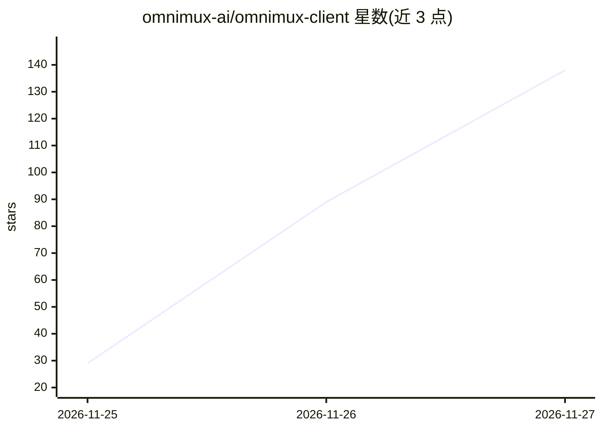

# omnimux-ai/omnimux-client

⭐ — · [GitHub]() · 组织维护 · 中文 README

**本地 AI 电商视频工作台：产品库+素材中心+工作流画布+时间线**

面向电商与创作者的本地优先桌面应用（macOS/Windows 安装包，内置运行时，无需 Node.js/CLI），基于 DeepSeek Harness 构建。核心模块：粘贴落地页提取卖点的产品库、6,382 项内置云端素材（数字人/场景/道具/钩子/音频/风格包）、Chrome 采集的灵感拆解、DAG 多模态工作流画布、多轨时间线剪辑室（本地导出 MP4）。用户可登录官方模型通道或自带 API key（BYOK），数据存储于本地 ~/.omnimux。

## 筛选速览

| 维度 | 判定 | 备注 |
|---|---|---|
| AI 角色 | `ai-native` | 本体是模型或模型工具 |
| 许可风险 | `dual` | — |
| 部署形态 | `desktop` | 安装包/桌面程序 |
| 模型依赖 | locked-api |  |
| 硬件要求 | — | 无带数字的原话,不猜 |
| 安装摩擦 | `low` | 无编译、无系统依赖或容器化 |
| 成熟度 | — | 结构信号不足 |

## 能力要点

- 产品库支持粘贴落地页 URL 提取卖点，并通过 @Product 在对话与画布中引用
- 内置 6,382 项云端素材：353+ 数字人（9 维筛选）、3,396 场景、940 道具、705 钩子等
- DAG 工作流画布与多轨时间线双表面协同，Agent 与人工共编同一工作区
- 内置 120+ 内容电商 Skills、100+ Expert 预设、12 个 MCP 连接器

## 适用场景

- 从产品链接生成 15 秒竖版商品视频并本地导出 MP4
- 用内置数字人与场景素材批量制作 UGC 口播与测评视频
- 采集对标视频并逐 clip 拆解钩子，转化为新的生产会话
- 以 SKILL.md 打包团队创意 SOP 供 Agent 复用

## 场景标签

`工作流自动化` `视频生成` · 领域:效率与自动化

## 证据(README 行号)

> L34: **OmniMux** solves the biggest headache in AI product video production: scattered prompts, inconsistent characters/
> L40: - 🔑 **Zero-CLI desktop app with local-first storage & BYOK** — Native macOS and Windows installers bundle the runti
> L164: |**Clip Studio** (`omnimux-clip`)|Edit on a three-pane multi-track timeline, inspect real composited frames, and e

## 星数曲线

2026-11-25 29 → 2026-11-27 138（+109）

---
*卡片 v1 · prompt 1.4 · 生成 2026-11-27 · 置信度 mid · 依据 README sha `5591eef4dded` · [字段定义](../../DATASET.md)*
