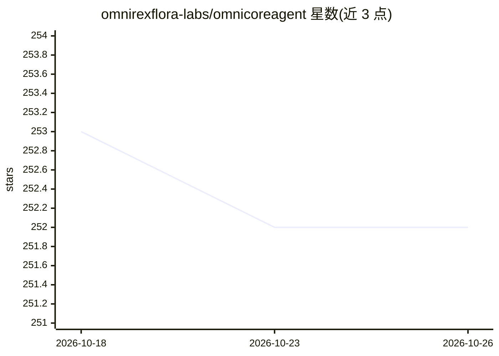

# omnirexflora-labs/omnicoreagent

⭐ 252 · Python · MIT · 推送 2026-10-09 · [GitHub](https://github.com/omnirexflora-labs/omnicoreagent) · [官网](https://docs-omnicoreagent.omnirexfloralabs.com/) · 组织维护

**Python agent 运行时：带策略审批、沙箱与可恢复运行的 agent harness**

面向 Python 开发者的 agent runtime：在模型外围提供循环、工具（含 MCP 客户端）、上下文、工作区与 sub-agent，并加入每动作策略（allow/ask/deny）、沙箱化命令执行、预算、可从崩溃中恢复的 durable run 与全量轨迹记录。可通过 Python、CLI 或 OmniServe HTTP 服务器使用；内存与任务存储支持 Redis/Postgres/MongoDB，遥测可导出至 OTLP/LangSmith/Opik/JSONL，并可在 Harbor 上跑 Terminal-Bench 基准。要求 Python 3.12–3.14，3.10/3.11 安装会中止。

## 筛选速览

| 维度 | 判定 | 备注 |
|---|---|---|
| AI 角色 | `ai-ecosystem` | LLM/agent 周边工具 |
| 许可风险 | `permissive` | MIT |
| 部署形态 | `library` | 以包/库形式分发 |
| 模型依赖 | local-ok | 支持本地模型 |
| 硬件要求 | — | 无带数字的原话,不猜 |
| 安装摩擦 | `low` | 无编译、无系统依赖或容器化 |
| 成熟度 | — | 结构信号不足 |

## 能力要点

- 每动作策略审批（allow/ask/deny）与前缀规则匹配的 shell 命令管控
- durable run：暂停恢复、进程死亡后从检查点继续、不重复非幂等调用
- 沙箱执行支持 Docker、E2B、Modal、Daytona、Vercel 等 provider
- 支持 MCP 服务器（stdio/SSE/streamable HTTP/OAuth）与 sub-agent worker profile

## 适用场景

- 构建需要人工审批与预算控制的后台 agent 任务
- 让 agent 在沙箱中执行 shell 命令并保留完整审计轨迹
- 通过 OmniServe 以 REST/SSE 服务化运行 agent
- 在 Harbor 上运行 Terminal-Bench 基准评估 agent

## 场景标签

`Agent 框架` · 领域:Agent 开发

## 证据(README 行号)

> L26: OmniCoreAgent is an **agent runtime** for Python. It includes the **harness**,
> L30: of every step. You use it from Python, from the command line, or as an HTTP

## 星数曲线

2026-10-18 253 → 2026-10-26 252（-1）

---
*卡片 v1 · prompt 1.4 · 生成 2026-10-22 · 置信度 high · 依据 README sha `0d91e932553c` · [字段定义](../../DATASET.md)*
