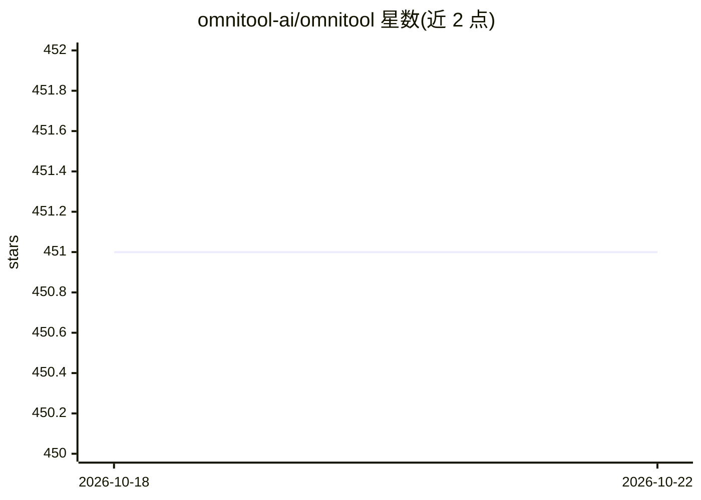

# omnitool-ai/omnitool

⭐ 451 · TypeScript · NOASSERTION · 推送 2026-05-30 · [GitHub](https://github.com/omnitool-ai/omnitool) · 组织维护

**开源本地自托管 AI 实验桌面：统一界面接入上千生成式 AI 模型**

面向学习者与 AI 爱好者的本地安装式浏览器桌面环境（'AI Lab in a box'），通过单一统一界面接入 OpenAI、Hugging Face、Replicate、Stability 等数十家云端 AI 提供商 API，以及 Ollama、LM Studio、Automatic1111 等本地服务。多数基于 OpenAPI3 的服务可不写代码生成可互操作'blocks'；支持客户端/服务端脚本与扩展（图像处理、白板、音频编辑等）；提供 recipe 系统、JWT 认证的 API 执行。需从源码用 Node.js/Yarn 构建运行，官方声明非生产/企业软件，Docker 镜像在计划中。

## 筛选速览

| 维度 | 判定 | 备注 |
|---|---|---|
| AI 角色 | `ai-ecosystem` | LLM/agent 周边工具 |
| 许可风险 | `none` | NOASSERTION |
| 部署形态 | `library` | 以包/库形式分发 |
| 模型依赖 | local-ok | 支持本地模型 |
| 硬件要求 | — | 无带数字的原话,不猜 |
| 安装摩擦 | `low` | 无编译、无系统依赖或容器化 |
| 成熟度 | `idea` | |

## 能力要点

- 统一界面接入数十家 AI 提供商及 Ollama/LM Studio/Automatic1111 等本地 API
- 基于 OpenAPI3 定义无代码生成 blocks，支持 x- 注解与 JSONATA 数据处理
- 客户端/服务端脚本与扩展框架，含 Replicate 模型导入、OpenPose、TLDraw 等扩展
- JWT 认证的 recipe 执行 API（POST /api/v1/workflow/exec）

## 适用场景

- 不写代码快速试用各云端与本地 AI 模型
- 通过浏览器在本机统一管理生成式 AI 图像/文本/音频/视频工作流
- 用 OpenAPI 定义把自有服务接入为可组合的 blocks

## 场景标签

 · 领域:生成式 AI 工具/桌面客户端

## 证据(README 行号)

> L15: Omnitool.ai is an open-source, downloadable "AI Lab in a box" built for learners, enthusiasts and anyone with inter
> L61: ### Comprehensive AI Provider Support
> L64: Currently supported:

## 星数曲线

2026-10-18 451 → 2026-10-22 451（+0）

---
*卡片 v1 · prompt 1.4 · 生成 2026-10-21 · 置信度 mid · 依据 README sha `623b639256ad` · [字段定义](../../DATASET.md)*
