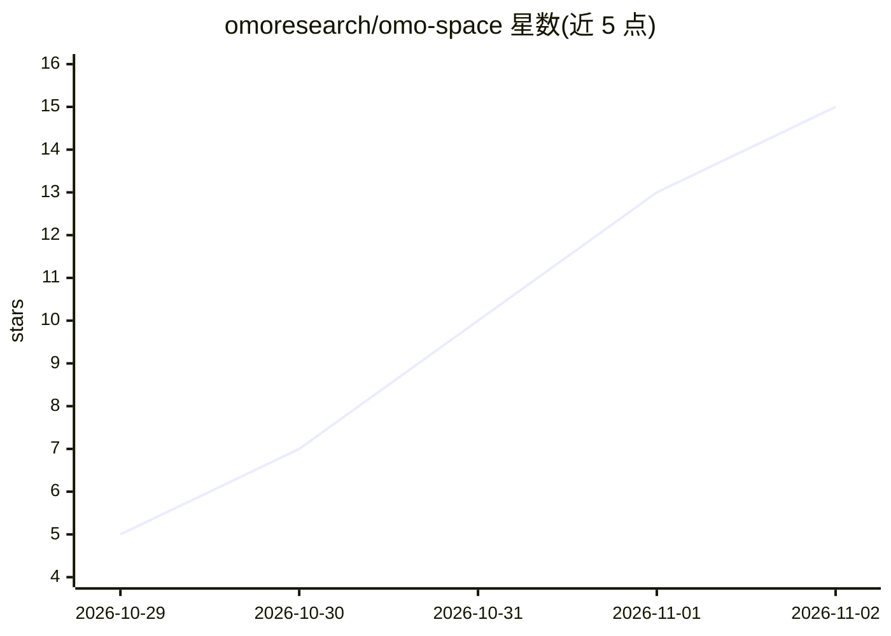

# omoresearch/omo-space

⭐ 15 · Python · MIT · 推送 2026-11-01 · [GitHub](https://github.com/omoresearch/omo-space) · [官网](https://www.omo.sh) · 组织维护

**在 Minecraft 里给 AI agent 安排房间的持久工作区模组**

Fabric Minecraft 模组加本地服务：放置方块即在自己 PC 上开启 Hermes、Claude Code、Codex 或普通 shell 的 tmux 后台会话，终端绘制在游戏内墙上，监视器可运行真实 Chromium 网页（最多 12 页）。会话由 tmux 会话服务器持有，退出游戏后仍在运行，重启后按原标签恢复且不重跑命令。还支持 agent 以玩家身份加入世界（LAN 端口拒绝离线登录）。安装为下载安装包运行 install.sh/install.ps1，Linux 端到端测试，macOS/Windows 仅离线测试；限制包括桌面 agent 不能在世界中行动、工作区仅存在于本机。

## 筛选速览

| 维度 | 判定 | 备注 |
|---|---|---|
| AI 角色 | `ai-ecosystem` | LLM/agent 周边工具 |
| 许可风险 | `permissive` | MIT |
| 部署形态 | `desktop` | 安装包/桌面程序 |
| 模型依赖 | — | README 未给出锁定关系 |
| 硬件要求 | — | 无带数字的原话,不猜 |
| 安装摩擦 | `medium` | 含编译或系统依赖之一 |
| 成熟度 | `idea` | |

## 能力要点

- 方块放置即在本地开启 tmux 持久会话（Hermes/Claude Code/Codex/shell）
- 退出游戏或重启后会话保留并按原标签恢复，不重跑命令
- 游戏内 Chromium 网页墙（最多 12 页，含内存保护策略）
- agent 可经 LAN 端口以玩家身份加入世界，端口拒绝其他机器的离线登录

## 适用场景

- 同时管理多个长时运行的编码 agent，用走到桌前的方式定位和恢复会话
- 在共享 3D 世界里按房间组织多阶段工作流（创意、录制、剪辑、发布）
- 把终端和网页监视器挂在墙上以查看各 agent 的实时状态

## 场景标签

`编码 Agent` · 领域:编码与开发

## 证据(README 行号)

> L8:  Place a computer block in Minecraft and a real Hermes Agent, Claude Code, Codex or plain shell starts on your own P
> L75:   C --> D["<b>Real agents</b> Hermes, Claude Code, Codex, shell <i>your PC</i>"]
> L80: 3. **Walk away.** tmux owns every session. Quit Minecraft and the work goes on while your PC is awake.

## 星数曲线

2026-10-29 5 → 2026-11-02 15（+10）

---
*卡片 v1 · prompt 1.4 · 生成 2026-10-31 · 置信度 high · 依据 README sha `2f5c0796d161` · [字段定义](../../DATASET.md)*
