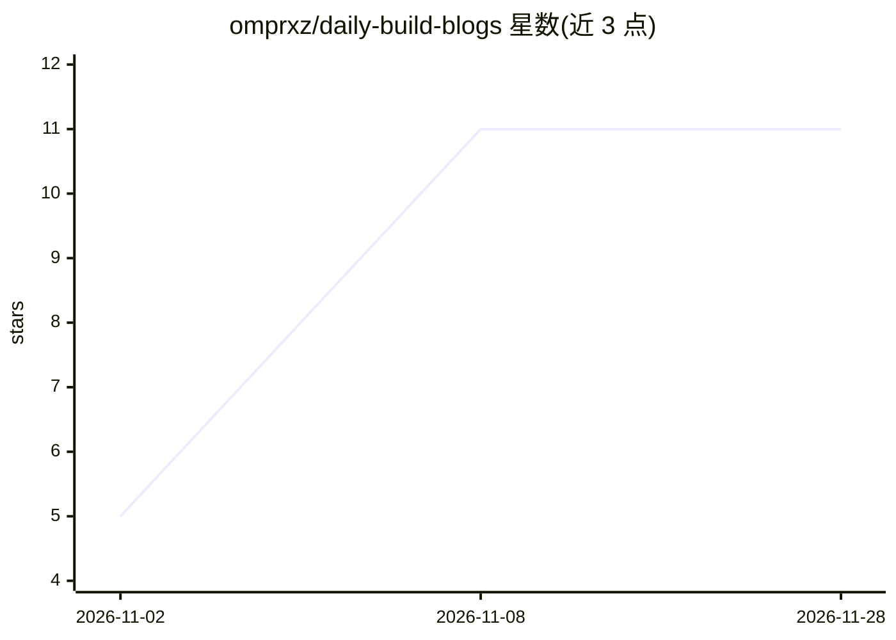

# omprxz/daily-build-blogs

⭐ 11 · TypeScript · NOASSERTION · 推送 2026-11-02 · [GitHub](https://github.com/omprxz/daily-build-blogs) · [官网](https://blogs.dailybuild.tech) · 个人维护

**面向技术出版团队的自动化 AI 新闻发布平台**

Node.js/React 自托管的内容发布平台：自动抓取 RSS 源、SHA-256 去重、AI 生成技术文章与 16:9 头图，通过 React SSR 输出含 JSON-LD 结构化数据的页面。支持拖拽工作流画布编排触发器与发布策略，内置 SEO/AEO 工具套件、发布前质量门与 Google Search Console/GA4 集成。连接时动态发现各提供商可用模型，支持 Node.js v20+ 与 PostgreSQL 14+ 的原生部署。

## 筛选速览

| 维度 | 判定 | 备注 |
|---|---|---|
| AI 角色 | `ai-enhanced` | 去掉 AI 部分产品仍成立 |
| 许可风险 | `permissive` | NOASSERTION |
| 部署形态 | `library` | 以包/库形式分发 |
| 模型依赖 | local-ok | 支持本地模型 |
| 硬件要求 | — | 无带数字的原话,不猜 |
| 安装摩擦 | `low` | 无编译、无系统依赖或容器化 |
| 成熟度 | `idea` | |

## 能力要点

- 多步自主发布管线：RSS 调研、去重、文章综合、头图生成
- 接入 8 个 AI 提供商，连接测试时动态发现可用模型（零硬编码）
- @xyflow/react 拖拽工作流画布编排 Cron/RSS/手动触发与发布策略
- 内置 15 项 SEO/AEO 工具与可配置发布前质量门（warning_only/approval_required/block_publication）

## 适用场景

- 技术团队自托管自动化新闻/博客站点
- 工程媒体自动聚合多家 RSS 源并生成综合文章
- 管理文章的 SEO 索引、AEO 可提取性与排名监控
- 通过可视化画布编排定时发布工作流

## 场景标签

`工作流自动化` `AI 写作` · 领域:效率与自动化

## 证据(README 行号)

> L21: - An autonomous multi-step publishing pipeline that surveys trusted RSS feeds, eliminates duplicate stories, synthe
> L28: - **Dynamic AI Model Discovery (Zero Hardcoding):** Dynamically inspects and lists real available models upon conne
> L37: - **Visual Workflow Automation Canvas:** Drag-and-drop node orchestration powered by `@xyflow/react` for triggers (

## 星数曲线

2026-11-02 5 → 2026-11-28 11（+6）

---
*卡片 v1 · prompt 1.4 · 生成 2026-11-18 · 置信度 high · 依据 README sha `ee07df5b2a75` · [字段定义](../../DATASET.md)*
