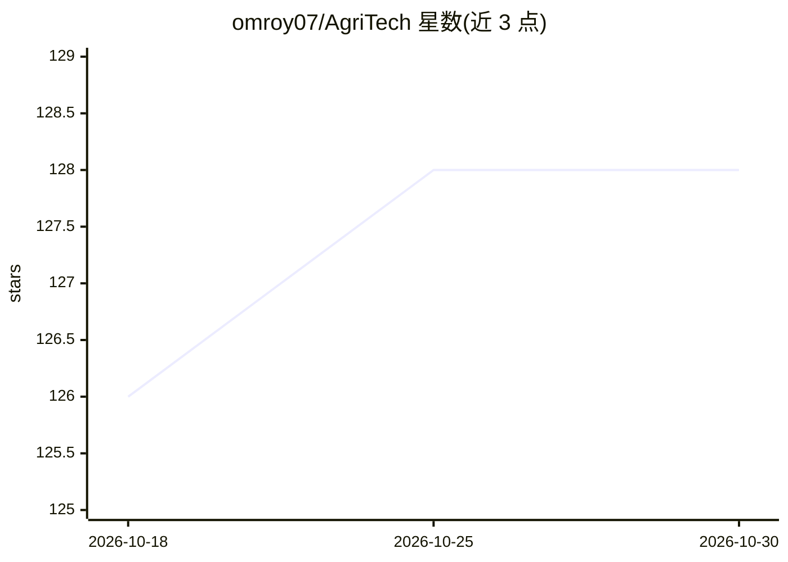

# omroy07/AgriTech

⭐ 128 · Jupyter Notebook · NOASSERTION · 推送 2026-10-20 · [GitHub](https://github.com/omroy07/AgriTech) · [官网](https://agri-tech-6rs5.vercel.app/) · 组织维护 · 中文 README

**面向农民的 AI 农业平台：作物推荐、产量预测、病害检测**

基于 Flask 后端与静态 HTML/CSS/JS 前端的 Web 平台，为农民提供作物与肥料推荐、产量预测、植物病害检测及农友社区、商家列表等协作功能。机器学习侧：CNN 做病害检测，Random Forest/XGBoost 做作物推荐，回归模型做产量预测；另含 Google Gemini 驱动、带规则回退的 AI 聊天机器人（可选 Node.js 服务）。需配置 Gemini 与 Firebase API key，注册仅限 Gmail 邮箱。生产部署建议用 gunicorn。

## 筛选速览

| 维度 | 判定 | 备注 |
|---|---|---|
| AI 角色 | `ai-native` | 本体是模型或模型工具 |
| 许可风险 | `permissive` | NOASSERTION |
| 部署形态 | `library` | 以包/库形式分发 |
| 模型依赖 | — | README 未给出锁定关系 |
| 硬件要求 | — | 无带数字的原话,不猜 |
| 安装摩擦 | `low` | 无编译、无系统依赖或容器化 |
| 成熟度 | — | 结构信号不足 |

## 能力要点

- CNN 病害检测 + Random Forest/XGBoost 作物推荐 + 回归产量预测
- Google Gemini AI 聊天机器人，含规则回退与离线 JSON 应答模式
- 农友社区与商家列表等协作功能
- OpenCV 图像清洗与 Firebase 认证

## 适用场景

- 上传植物照片识别病害并获取处置建议
- 依据土壤数据获取作物与肥料推荐
- 预测作物产量并获取季节性农事建议

## 场景标签

`聊天机器人` `目标检测` · 领域:对话与助手

## 证据(README 行号)

> L17: **AgriTech** is an AI-powered smart agriculture platform designed to assist farmers with crop
> L93:  - CNNs for disease detection
> L94:  - Random Forest / XGBoost for crop recommendation
> L95:  - Regression models for yield prediction

## 星数曲线

2026-10-18 126 → 2026-10-30 128（+2）

---
*卡片 v1 · prompt 1.4 · 生成 2026-10-23 · 置信度 mid · 依据 README sha `0ff319f0ad6c` · [字段定义](../../DATASET.md)*
