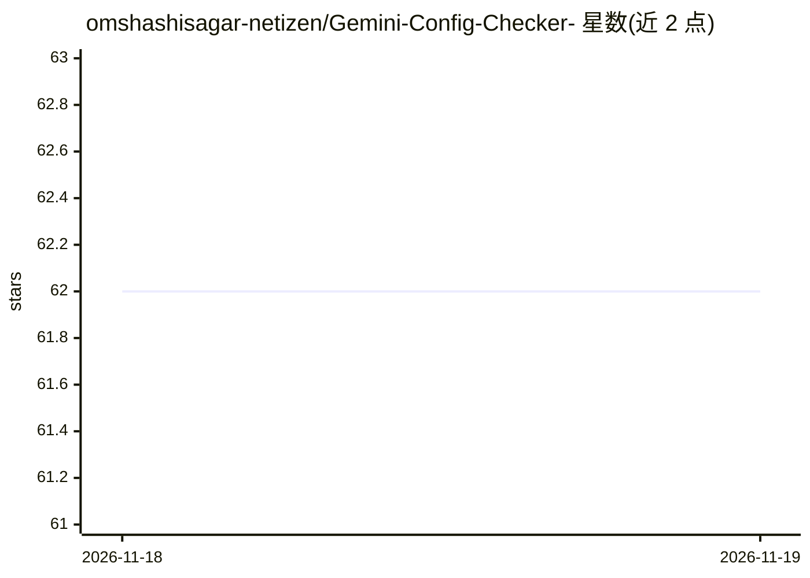

# omshashisagar-netizen/Gemini-Config-Checker-

⭐ 62 · Go · Apache-2.0 · 推送 2026-11-18 · [GitHub](https://github.com/omshashisagar-netizen/Gemini-Config-Checker-) · 个人维护 · 中文 README

**检测代理配置能否登录使用 Google AI Studio 与 Gemini**

桌面/移动/Web 工具，用登录浏览器逐条测试代理配置是否可访问 AI Studio 与 Gemini，支持 vless/vmess/trojan/ss 链接、订阅 URL 与 base64 输入。提供 Simple（检测自有配置）与 Advanced（在基础配置后链式扫描免费配置）两种模式，内置反 DPI 片段化转发器，可导出链接、base64 或链式 Xray 配置。区域检测依赖 Chrome/Edge/Brave 并需登录 Google 账号；Android 仅支持连通性模式。当前为 0.1.0 早期预发布版。

## 筛选速览

| 维度 | 判定 | 备注 |
|---|---|---|
| AI 角色 | `ai-enhanced` | 去掉 AI 部分产品仍成立 |
| 许可风险 | `permissive` | Apache-2.0 |
| 部署形态 | `desktop` | 安装包/桌面程序 |
| 模型依赖 | — | README 未给出锁定关系 |
| 硬件要求 | — | 无带数字的原话,不猜 |
| 安装摩擦 | `medium` | 含编译或系统依赖之一 |
| 成熟度 | `idea` | |

## 能力要点

- 登录浏览器实测区域封锁（AI Studio 重定向与 Gemini 区域墙判定）
- Simple/Advanced 双模式：自有配置检测与免费配置链式扫描
- 内置可编辑的反 DPI 配置（Finalmask 片段、指纹、ALPN、密码套件）
- 导出链接、base64 与链式 Xray 配置，附 SHA256SUMS 校验

## 适用场景

- 批量筛出能进入 Google AI Studio 的可用配置
- 依赖某配置前先验证其区域可用性
- Cloudflare 配置连通但被区域墙拦截时寻找其他出口

## 场景标签

 · 领域:网络工具/代理配置检测

## 证据(README 行号)

> L11: Find proxy configs that actually get you into **Google AI Studio and Gemini**, by testing each one the way a person
> L155: |Check type|Region with signed-in browser|**Region**: opens AI Studio and Gemini and reads Google's verdict (accur

## 星数曲线

2026-11-18 62 → 2026-11-19 62（+0）

---
*卡片 v1 · prompt 1.4 · 生成 2026-11-19 · 置信度 mid · 依据 README sha `7119c240ac42` · [字段定义](../../DATASET.md)*
