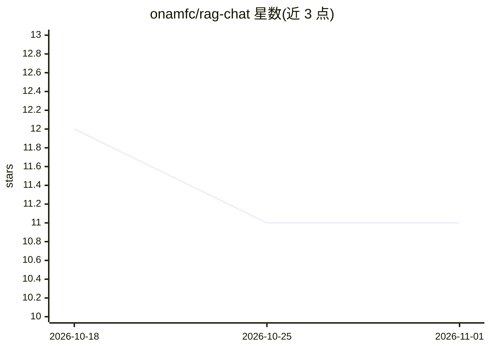

# onamfc/rag-chat

⭐ 11 · TypeScript · MIT · 推送 2025-11-08 · [GitHub](https://github.com/onamfc/rag-chat) · 个人维护

**私有部署的文档问答 RAG 系统，支持本地模型与 MCP 工具**

面向需要隐私的文档对话场景：上传 PDF/DOCX/TXT/Markdown 后以 RAG 检索生成回答。后端为 FastAPI + LlamaIndex，提供 Streamlit 界面、OpenAI 兼容 REST API 与 Python 客户端。LLM 后端可选 Ollama 完全本地运行，或切换 OpenAI/Anthropic 云端及混合模式；向量库支持 ChromaDB/Qdrant，可调 chunk 与 top-k。通过 MCP 接入计算器、文件系统等外部工具，安装需 git clone 源码、pip 装依赖并跑两个启动脚本。

## 筛选速览

| 维度 | 判定 | 备注 |
|---|---|---|
| AI 角色 | `ai-native` | 本体是模型或模型工具 |
| 许可风险 | `permissive` | MIT |
| 部署形态 | `library` | 以包/库形式分发 |
| 模型依赖 | local-ok | 支持本地模型 |
| 硬件要求 | — | 无带数字的原话,不猜 |
| 安装摩擦 | `low` | 无编译、无系统依赖或容器化 |
| 成熟度 | — | 结构信号不足 |

## 能力要点

- 多 LLM 后端：Ollama 本地 / OpenAI / Anthropic / 混合（云 LLM+本地嵌入）
- MCP 集成：接入计算器、文件系统、文本处理、天气等外部工具
- 三种接口：Streamlit UI、OpenAI 兼容 API、Python 客户端
- RAG 可调参数：chunk 大小、overlap、similarity_top_k；向量库可换 ChromaDB/Qdrant

## 适用场景

- 在本地私有化地与 PDF、Word 等文档对话，数据不出本机
- 为文档问答需求提供 OpenAI 兼容 API 供其他系统集成
- 通过 MCP 工具让回答过程调用计算器、文件系统等外部能力

## 场景标签

`文档问答` · 领域:知识与检索

## 证据(README 行号)

> L3: **A production-ready RAG (Retrieval Augmented Generation) system for chatting with your documents**
> L15: Xantus is a **privacy-first** RAG system that lets you chat with your documents using AI. Unlike cloud-only solutio
> L30: - **Document Chat**: Upload PDFs, DOCX, TXT, Markdown and chat with them

## 星数曲线

2026-10-18 12 → 2026-11-01 11（-1）

---
*卡片 v1 · prompt 1.4 · 生成 2026-11-01 · 置信度 mid · 依据 README sha `07b3ac82013d` · [字段定义](../../DATASET.md)*
