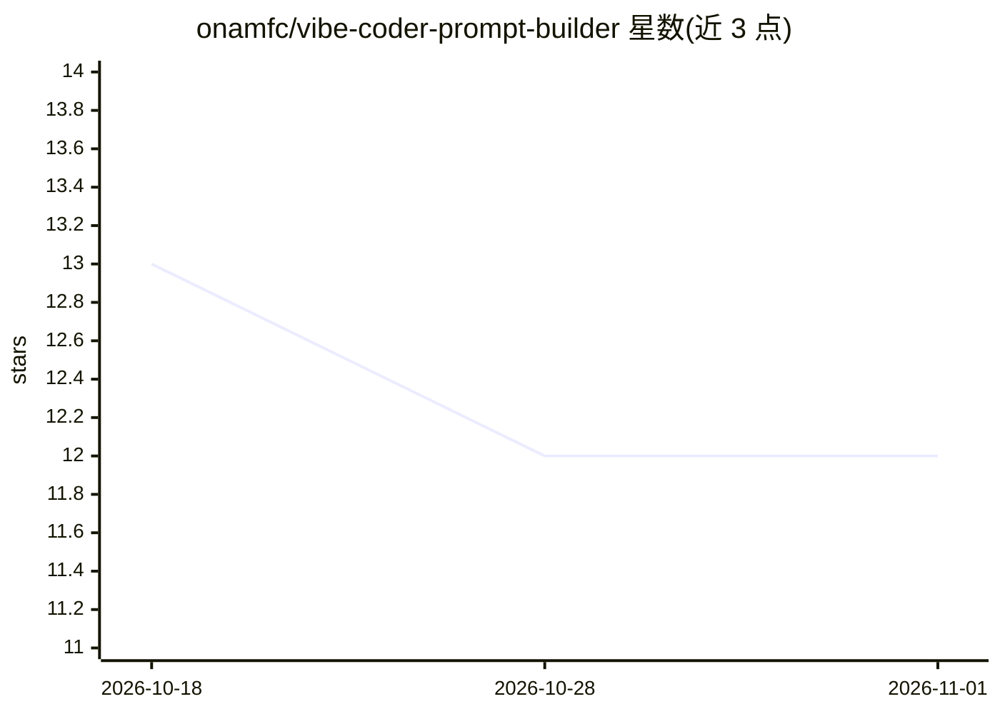

# onamfc/vibe-coder-prompt-builder

⭐ 12 · TypeScript · 推送 2025-12-04 · [GitHub](https://github.com/onamfc/vibe-coder-prompt-builder) · [官网](https://vibe-coder-prompt-builder.vercel.app) · 个人维护

**帮助 vibe coder 生成生产级项目规格提示词的 React 应用**

面向 'vibe coder'（有想法但缺乏专业工程知识）开发者的 React 向导式应用：通过 9 步向导收集项目类型、功能、技术栈、测试策略与专业需求（认证、安全、性能等），自动附加行业最佳实践，生成供 Claude、ChatGPT 等 AI 代码生成工具使用的项目规格提示词。AI 集成采用 OpenAI GPT-4o-mini 提供功能与技术栈建议，API key 通过 serverless 函数在服务端使用。需 Node.js 16+ 与 npm 7+，从源码克隆运行，测试基于 Vitest。

## 筛选速览

| 维度 | 判定 | 备注 |
|---|---|---|
| AI 角色 | `ai-ecosystem` | LLM/agent 周边工具 |
| 许可风险 | `none` | — |
| 部署形态 | `library` | 以包/库形式分发 |
| 模型依赖 | — | README 未给出锁定关系 |
| 硬件要求 | — | 无带数字的原话,不猜 |
| 安装摩擦 | `low` | 无编译、无系统依赖或容器化 |
| 成熟度 | — | 结构信号不足 |

## 能力要点

- 9 步向导覆盖项目类型、功能、技术栈、测试与专业需求
- 自动附加错误处理、无障碍、CI/CD 等 9 项强制最佳实践
- 基于 GPT-4o-mini 的功能/技术栈 AI 建议
- 生成的提示词按 12 个评估维度达到 9-10/10 评分

## 适用场景

- 为 Claude/ChatGPT 等 AI 编码工具编写完整项目规格
- 补充我不知道的生产级需求（认证、安全、监控）
- 让 AI 生成的代码从第一天起符合专业标准

## 场景标签

`提示工程` · 领域:Agent 开发

## 证据(README 行号)

> L3: A React-based application that helps developers create comprehensive, production-ready project specifications for AI
> L16: The generated specifications are optimized for use with AI code generation tools like Claude, ChatGPT, or other AI 
> L20: - **Guided Workflow**: 9-step wizard that walks users through every aspect of their project

## 星数曲线

2026-10-18 13 → 2026-11-01 12（-1）

---
*卡片 v1 · prompt 1.4 · 生成 2026-11-01 · 置信度 high · 依据 README sha `eff3b322be8d` · [字段定义](../../DATASET.md)*
