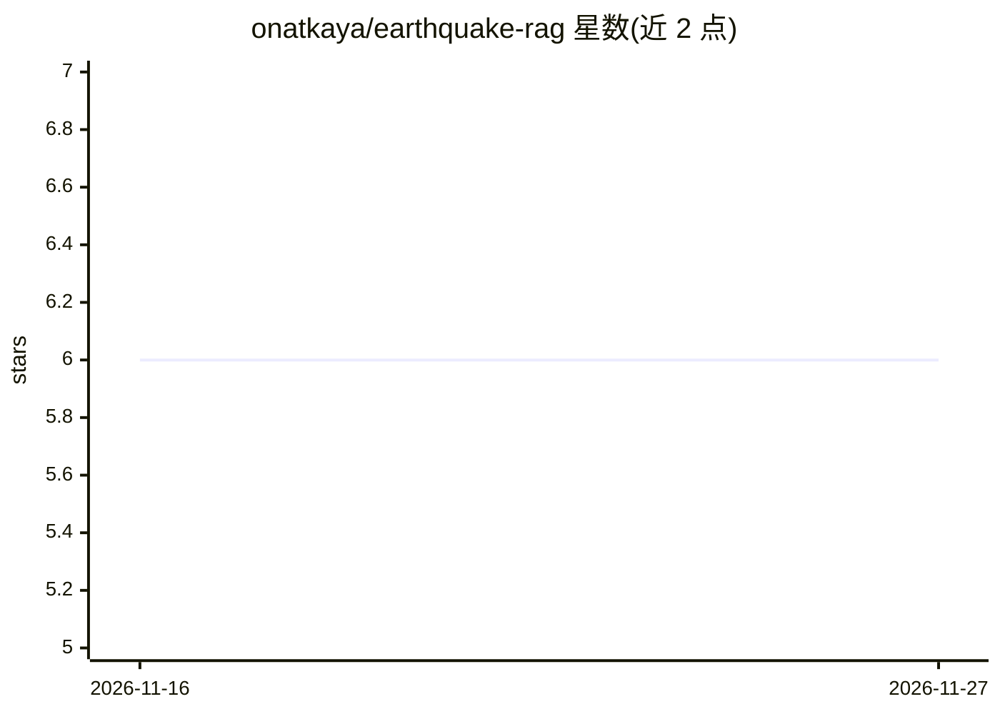

# onatkaya/earthquake-rag

⭐ 6 · Python · MIT · 推送 2026-11-07 · [GitHub](https://github.com/onatkaya/earthquake-rag) · [官网](https://www.kaggle.com/datasets/onatkaya1/turkey-earthquake-relief-tweets-dataset/data) · 个人维护

**基于 2023 土耳其地震推文的本地 RAG 问答助手**

读取 2023 年 2 月 6 日土耳其地震推文数据集，将其向量化存入 Chroma 数据库；用户用土耳其语提问时检索最相关的 30 条推文，交给本地土耳其语 LLM 生成有出处的回答。全部组件在本地运行，数据与问题不出本机，无需云订阅或按次付费。自带四个推文预处理脚本（去重、标签转换、电话号码脱敏、文本清洗），并提供 Kaggle 数据集来源说明。

## 筛选速览

| 维度 | 判定 | 备注 |
|---|---|---|
| AI 角色 | `ai-native` | 本体是模型或模型工具 |
| 许可风险 | `permissive` | MIT |
| 部署形态 | `None` |  |
| 模型依赖 | local-ok | 支持本地模型 |
| 硬件要求 | — | 无带数字的原话,不猜 |
| 安装摩擦 | `low` | 无编译、无系统依赖或容器化 |
| 成熟度 | — | 结构信号不足 |

## 能力要点

- 本地运行的 RAG 问答，回答可溯源到真实推文
- 使用土耳其语模型 Turkcell-LLM-7b-v1 生成回答
- Chroma 向量数据库支持按语义而非关键词检索
- 附推文预处理工具链（去重/标签/脱敏/清洗）

## 适用场景

- 用土耳其语查询地震期间推文中求助与援助信息
- 替代人工翻阅数百条推文获取事件上下文
- 参考其流程复现社交媒体数据的本地 RAG 应用

## 场景标签

`RAG` `文档问答` · 领域:知识与检索

## 证据(README 行号)

> L12: This is a RAG-based AI assistant that answers questions about tweets from the February 6, 2023 earthquake in Turkey
> L20: - **RAG** (Retrieval-Augmented Generation) - answers come from real tweets, not from the model's memory, so you can
> L39: 4. Those tweets are handed to a Turkish-language AI model, which reads

## 星数曲线

2026-11-16 6 → 2026-11-27 6（+0）

---
*卡片 v1 · prompt 1.4 · 生成 2026-11-20 · 置信度 high · 依据 README sha `26480d0aa1ec` · [字段定义](../../DATASET.md)*
