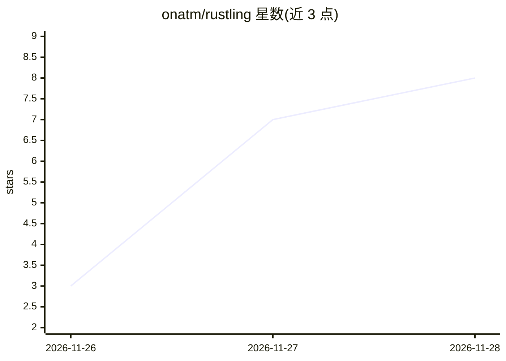

# onatm/rustling

⭐ 8 · Rust · Apache-2.0 · 推送 2026-11-27 · [GitHub](https://github.com/onatm/rustling) · 个人维护

**为 Inkling 2 Mini 模型在 Apple silicon 上提供本地推理的 Rust 引擎**

用 Rust 编写的本地推理引擎，专门服务 Inkling 2 Mini 一个模型家族，面向编码 agent 场景。提供 chat、generate、serve 三种用法：chat 是进程内的目录级助手，可读取/搜索文件并接入 MCP 服务器；serve 暴露 OpenAI 兼容 API（/v1/chat/completions、/v1/responses），支持流式与工具调用，Codex、aider、opencode 可直接接入。针对该模型做了整 token 单次 GPU 提交、提示缓存跨请求与重启保留、对话重复片段复制等优化。仅支持 Apple silicon Mac（Metal），CPU 后端可用，需 Rust 工具链构建，模型权重约 16.6 GB。

## 筛选速览

| 维度 | 判定 | 备注 |
|---|---|---|
| AI 角色 | `ai-ecosystem` | LLM/agent 周边工具 |
| 许可风险 | `permissive` | Apache-2.0 |
| 部署形态 | `library` | 以包/库形式分发 |
| 模型依赖 | — | README 未给出锁定关系 |
| 硬件要求 | — | 无带数字的原话,不猜 |
| 安装摩擦 | `high` | 编译与系统依赖俱全 |
| 成熟度 | — | 结构信号不足 |

## 能力要点

- OpenAI 兼容 API，Codex/aider/opencode 可按托管模型方式接入
- 仅服务一个模型家族，整 token 单次 GPU 提交、提示缓存跨重启保留
- chat 支持 MCP 服务器（HTTP/stdio）、AGENTS.md 指令约定与会话续接
- 支持推理力度分级控制（--effort none 到 max）与 CPU 后端（含 draft model）

## 适用场景

- 在 Apple silicon Mac 上为 Codex/aider 等编码 agent 提供本地模型后端
- 在终端内对当前目录代码提问并让模型读取、搜索文件
- 通过 OpenAI 兼容端点向其他程序提供 Inkling 2 Mini 推理服务

## 场景标签

`推理引擎` · 领域:训练与推理

## 证据(README 行号)

> L3: A fast local inference engine for Inkling 2 Mini on
> L4: Apple silicon, written in Rust and built for coding agents. It serves an OpenAI-compatible API that Codex, aider
> L17: - An Apple silicon Mac. Nothing else is supported: the engine is built around Metal and tuned on these chips.

## 星数曲线

2026-11-26 3 → 2026-11-28 8（+5）

---
*卡片 v1 · prompt 1.4 · 生成 2026-11-26 · 置信度 high · 依据 README sha `cfd28554efbf` · [字段定义](../../DATASET.md)*
