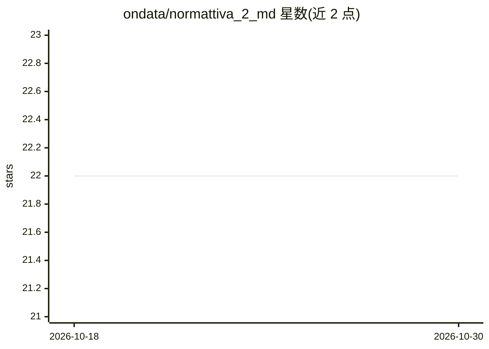

# ondata/normattiva_2_md

⭐ 22 · Python · MIT · 推送 2026-06-05 · [GitHub](https://github.com/ondata/normattiva_2_md) · [官网](https://ondata.github.io/normattiva_2_md/) · 组织维护

**把意大利法律 Akoma Ntoso XML 转成 Markdown 供 LLM 使用**

命令行工具兼 Python 库，读取 normattiva.it 的法律文档（Akoma Ntoso 3.0 XML），转换为带 YAML front matter 的结构化 Markdown，面向需要把法条作为 LLM 上下文或接入 AI/RAG 流水线的开发者。支持按条款过滤（--art）、导出实施规定 CSV、通过 Exa AI API 做自然语言法律检索（可选，需 API key）。README 声明转换文本无官方法律效力，以意大利官方公报为准。发布于 PyPI。

## 筛选速览

| 维度 | 判定 | 备注 |
|---|---|---|
| AI 角色 | `ai-ecosystem` | LLM/agent 周边工具 |
| 许可风险 | `permissive` | MIT |
| 部署形态 | `library` | 以包/库形式分发 |
| 模型依赖 | — | README 未给出锁定关系 |
| 硬件要求 | — | 无带数字的原话,不猜 |
| 安装摩擦 | `low` | 无编译、无系统依赖或容器化 |
| 成熟度 | — | 结构信号不足 |

## 能力要点

- Akoma Ntoso 3.0 XML → 结构化 Markdown（H1-H4 层级 + YAML 元数据）
- --art 按条款提取，支持 16bis/3ter 等编号
- 可选 Exa AI 自然语言检索法律（-s，需 API key）
- 导出法律实施规定为 7 列 CSV

## 适用场景

- 把意大利法条转换成 Markdown 作为 LLM 上下文
- 构建法律问答/检索流水线时批量整理法条
- 按条款号快速提取单个法条文本

## 场景标签

`文档解析` · 领域:知识与检索

## 证据(README 行号)

> L9: **Normattiva2MD** è uno strumento da riga di comando progettato per convertire documenti XML in formato **Akoma Ntos
> L40: - ✅ **Machine-to-machine ready** per LLM, RAG e parsing automatici

## 星数曲线

2026-10-18 22 → 2026-10-30 22（+0）

---
*卡片 v1 · prompt 1.4 · 生成 2026-10-27 · 置信度 high · 依据 README sha `729187adb9a8` · [字段定义](../../DATASET.md)*
