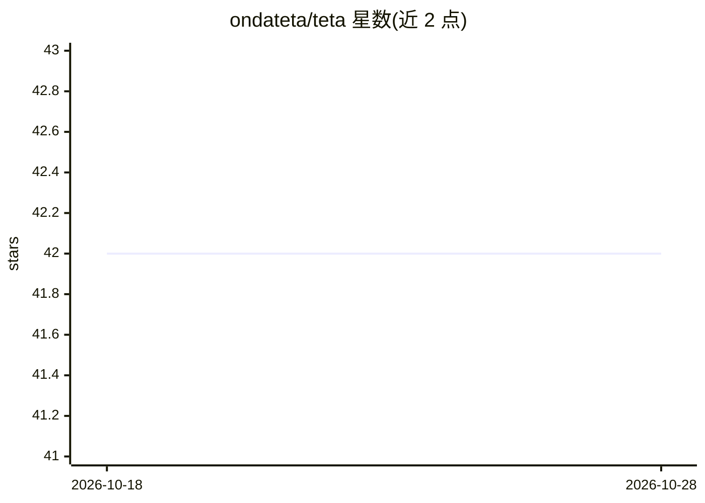

# ondateta/teta

⭐ 42 · Dart · AGPL-3.0 · 推送 2025-12-10 · [GitHub](https://github.com/ondateta/teta) · [官网](https://teta.so) · 组织维护

**开源 AI 应用构建器：用描述生成移动应用（macOS）**

Teta 是开源的 AI 驱动应用构建器，用户通过描述来构建移动应用。开源版本仅包含编辑器，面向单一项目工作，项目路径须通过 .env 文件声明；架构由两部分组成：pkgs/server 轻量服务端负责项目管理操作，apps/desktop 为 Flutter 桌面应用承载编程编辑器，两者均需运行。目前仅提供 macOS 版本，其他平台版本在开发中，产品处于 technical preview 阶段且持续更新。运行前需系统安装 Git 与 Flutter。

## 筛选速览

| 维度 | 判定 | 备注 |
|---|---|---|
| AI 角色 | `ai-native` | 本体是模型或模型工具 |
| 许可风险 | `viral` | AGPL-3.0 |
| 部署形态 | `None` |  |
| 模型依赖 | — | README 未给出锁定关系 |
| 硬件要求 | — | 无带数字的原话,不猜 |
| 安装摩擦 | `low` | 无编译、无系统依赖或容器化 |
| 成熟度 | `idea` | |

## 能力要点

- 通过自然语言描述构建移动应用
- 开源版包含本地编辑器，支持单一项目
- 由 server（项目管理）与 Flutter 桌面编辑器两部分组成

## 适用场景

- 用描述快速生成移动应用原型
- 在本地开源编辑器中开发 Flutter 应用

## 场景标签

`代码生成` · 领域:编码与开发

## 证据(README 行号)

> L5:  The open source, AI-powered app builder
> L9:  Build a mobile app by describing it.

## 星数曲线

2026-10-18 42 → 2026-10-28 42（+0）

---
*卡片 v1 · prompt 1.4 · 生成 2026-10-25 · 置信度 mid · 依据 README sha `16280628bc1c` · [字段定义](../../DATASET.md)*
