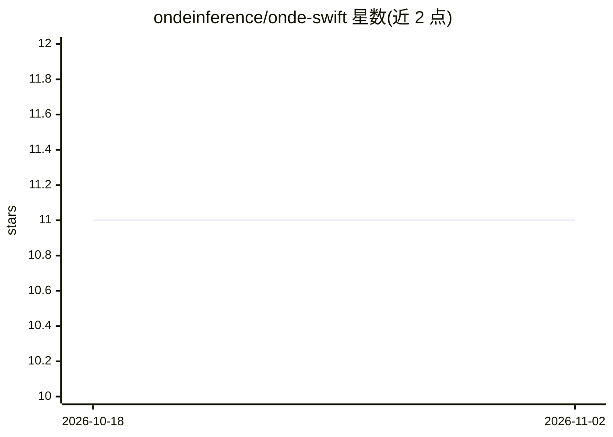

# ondeinference/onde-swift

⭐ 11 · Swift · Apache-2.0 · 推送 2026-10-31 · [GitHub](https://github.com/ondeinference/onde-swift) · [官网](https://swiftpackageindex.com/ondeinference/onde-swift) · 组织维护

**在 Apple 设备上本地运行 LLM 的 Swift SDK**

面向 Swift 开发者的端侧 LLM 推理 SDK，底层为 Rust 核心（onde 仓库），通过 SwiftPM 集成到 Xcode 工程。提供 OndeChatEngine 会话推理、流式输出（StreamChunkListener）与一次性生成 API；iOS/macOS/tvOS 均以 Metal 作为 GPU 后端，最低支持 iOS 15 / macOS 11。针对沙盒应用提供 HF_HOME 指向 App Group 共享容器的初始化辅助，使多个应用共享已下载模型；配套 Onde CLI 可在接入前测试模型下载与 GGUF 导出。由 Splitfire AB 维护。

## 筛选速览

| 维度 | 判定 | 备注 |
|---|---|---|
| AI 角色 | `ai-ecosystem` | LLM/agent 周边工具 |
| 许可风险 | `permissive` | Apache-2.0 |
| 部署形态 | `None` |  |
| 模型依赖 | — | README 未给出锁定关系 |
| 硬件要求 | — | 无带数字的原话,不猜 |
| 安装摩擦 | `low` | 无编译、无系统依赖或容器化 |
| 成熟度 | — | 结构信号不足 |

## 能力要点

- SwiftPM 集成，Rust 核心编译为 xcframework 供 Xcode 链接
- 流式输出与 One-Shot 生成两种推理接口
- iOS/macOS/tvOS 平台均使用 Metal GPU 后端
- 沙盒应用的 HF_HOME 共享容器方案，跨应用共享模型

## 适用场景

- 在 iOS/macOS 应用中集成端侧 LLM 对话与流式生成
- 多个沙盒应用共享同一份已下载模型以节省空间
- 用配套 CLI 先验证模型下载与 GGUF 导出再接入 Swift

## 场景标签

`推理引擎` · 领域:训练与推理

## 证据(README 行号)

> L5:  Run LLMs on-device from Swift with Onde Inference, with first-class support for Apple silicon.
> L45: let engine = OndeChatEngine()

## 星数曲线

2026-10-18 11 → 2026-11-02 11（+0）

---
*卡片 v1 · prompt 1.4 · 生成 2026-11-01 · 置信度 high · 依据 README sha `ece7d333f1ad` · [字段定义](../../DATASET.md)*
