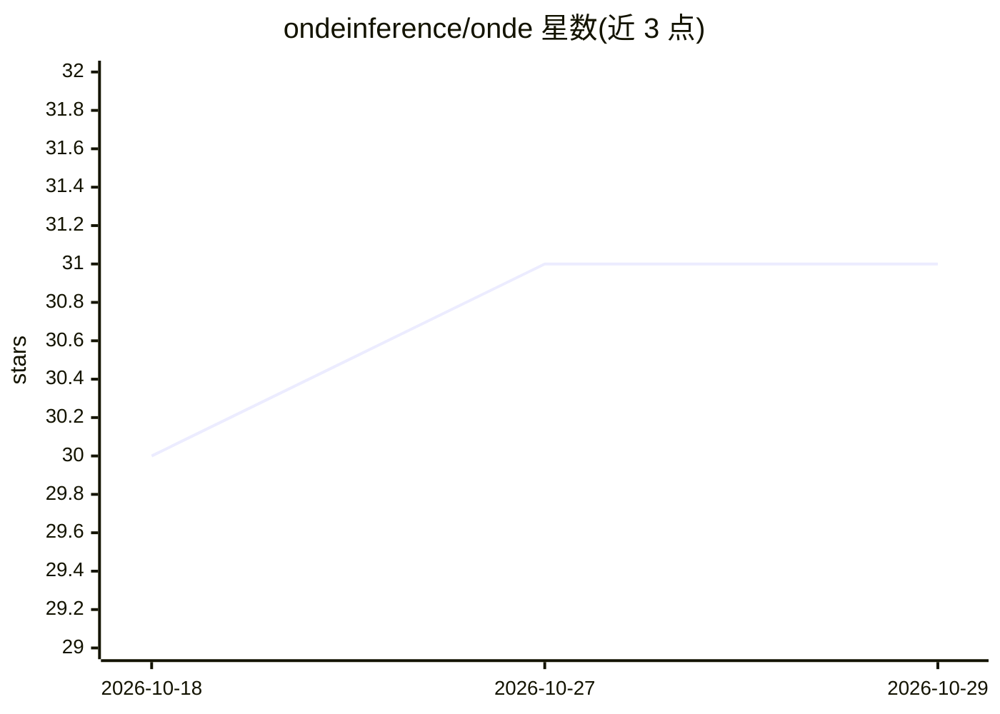

# ondeinference/onde

⭐ 31 · Rust · Apache-2.0 · 推送 2026-10-19 · [GitHub](https://github.com/ondeinference/onde) · [官网](https://ondeinference.com/sdk) · 组织维护

**面向 Apple silicon 等设备的端侧 LLM 推理 SDK，支持多平台接入**

由 Splitfire AB 维护的端侧 LLM 推理引擎，基于 mistral.rs 构建，通过同一 ChatEngine 加载 GGUF 与 UQFF 两种量化模型格式，聊天全程在设备本地运行、无服务器往返。以 Rust 实现并通过 UniFFI 提供 Swift、Kotlin Multiplatform、Flutter、React Native 等多平台 SDK，发布于 crates.io、Maven Central、Swift Package Index、pub.dev 与 npm。配套 Onde CLI 用于测试下载、模型选择与 GGUF 导出，另有开源参考应用 Siti AI（Tauri，覆盖 macOS/iOS/Android）。各模型自带独立许可，需自行合规。

## 筛选速览

| 维度 | 判定 | 备注 |
|---|---|---|
| AI 角色 | `ai-ecosystem` | LLM/agent 周边工具 |
| 许可风险 | `permissive` | Apache-2.0 |
| 部署形态 | `library` | 以包/库形式分发 |
| 模型依赖 | — | README 未给出锁定关系 |
| 硬件要求 | — | 无带数字的原话,不猜 |
| 安装摩擦 | `low` | 无编译、无系统依赖或容器化 |
| 成熟度 | — | 结构信号不足 |

## 能力要点

- 同一引擎加载 GGUF 与 UQFF（mistral.rs 原生预量化格式）
- 聊天完全在设备本地运行，无服务器往返
- Swift / Kotlin Multiplatform / Flutter / React Native 多平台 SDK
- 配套开源参考应用 Siti AI 与 Onde CLI

## 适用场景

- 在 macOS/iOS/Android 应用中嵌入本地 LLM 聊天能力
- 在接入引擎前用 CLI 测试模型下载、选择与 GGUF 导出
- 参考 Siti AI 源码学习引擎接入方式

## 场景标签

`推理引擎` · 领域:训练与推理

## 证据(README 行号)

> L5:  Run LLMs on-device with Onde Inference, with first-class support for Apple silicon.
> L33: Onde can load GGUF models and UQFF models through the same chat engine. UQFF is mistral.rs' native pre-quantized fo
> L15:  Swift SDK · Kotlin Multiplatform SDK · Flutter SDK · React Native SDK · Website

## 星数曲线

2026-10-18 30 → 2026-10-29 31（+1）

---
*卡片 v1 · prompt 1.4 · 生成 2026-10-26 · 置信度 high · 依据 README sha `7e71c8a4884d` · [字段定义](../../DATASET.md)*
