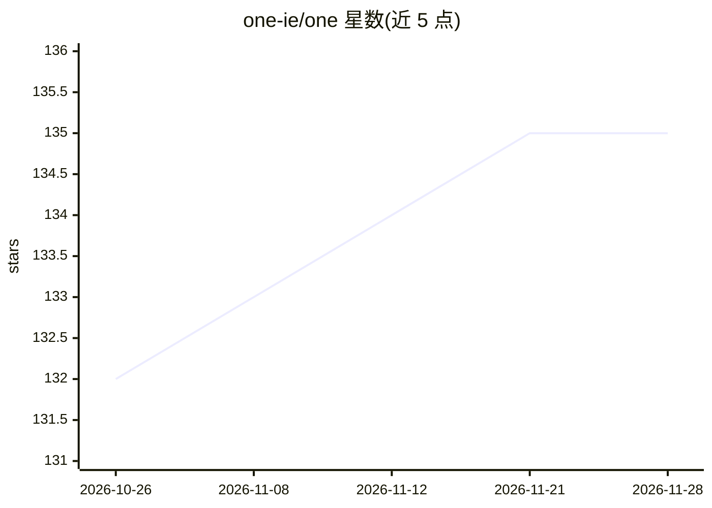

# one-ie/one

⭐ 135 · Astro · NOASSERTION · 推送 2026-11-23 · [GitHub](https://github.com/one-ie/one) · [官网](https://template.one.ie) · 组织维护

**开发者用 Markdown 定义 agents/skills/workflows 并随 Astro 站点一起构建部署**

一个开源网站/应用起步仓库，基于 Astro 7、React 19、shadcn/ui 与 Tailwind 4，可独立运行（本地 auth + D1），也可通过 ONE_API_KEY 接入其托管后端获得聊天、CRM、分析、页面编辑器等插件。仓库另一半是 ai/ 目录：agent、skill、workflow 均以 Markdown/TOML 文件定义，提供 16 个 agent 模板、5 个 skill 和 8 种步骤类型的工作流图（含 human 人工审批步骤），用 one push 编译并推送到 ONE workspace 运行。面向开发者的部署路径是 npx oneie create 加 bun run deploy 到自己的 Cloudflare 账户。

## 筛选速览

| 维度 | 判定 | 备注 |
|---|---|---|
| AI 角色 | `ai-ecosystem` | LLM/agent 周边工具 |
| 许可风险 | `none` | NOASSERTION |
| 部署形态 | `library` | 以包/库形式分发 |
| 模型依赖 | — | README 未给出锁定关系 |
| 硬件要求 | — | 无带数字的原话,不猜 |
| 安装摩擦 | `low` | 无编译、无系统依赖或容器化 |
| 成熟度 | — | 结构信号不足 |

## 能力要点

- agent/skill/workflow 均为 Markdown 与 TOML 文件，可在 PR 中评审
- 16 个 agent 模板与 5 个 skill 随仓库提供
- 工作流含 8 种步骤类型，支持 human 步骤人工审批
- 支持独立运行（无 key）与接入 ONE 后端两种模式，插件按构建时配置挂载

## 适用场景

- 快速搭建可部署到 Cloudflare 的博客、文档或商店站点
- 用 Markdown 文件定义业务 agent 并纳入代码评审流程
- 编排带人工审批环节的订单处理等工作流

## 场景标签

`工作流自动化` · 领域:效率与自动化

## 证据(README 行号)

> L48:  🤖 Agents
> L100: The site is half of ONE. The other half is `ai/`: the agents that run your business, the skills they use and the w
> L186: |||

## 星数曲线

2026-10-26 132 → 2026-11-28 135（+3）

---
*卡片 v1 · prompt 1.4 · 生成 2026-11-28 · 置信度 high · 依据 README sha `484303f3703f` · [字段定义](../../DATASET.md)*
