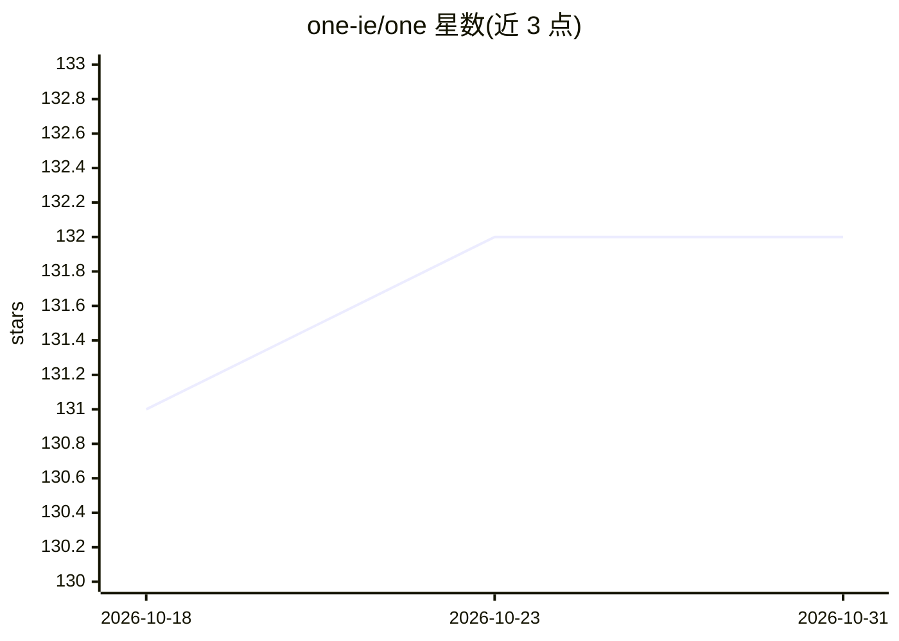

# one-ie/one

⭐ 132 · Astro · NOASSERTION · 推送 2026-10-11 · [GitHub](https://github.com/one-ie/one) · [官网](https://template.one.ie) · 组织维护

**带支付与 AI agent 配置的 Astro/React 网站起步模板**

基于 Astro 7、React 19、shadcn/ui、Tailwind 4 的网站起步模板，内置两条支付通道：跨 Sui/Ethereum/Solana/Bitcoin 四链的加密支付链接与 Stripe Elements 卡片支付，价格在服务端解析。含 Better Auth/D1 会话、内容集合、SEO 校验与主题系统。仓库附带 .claude/、.mcp.json 与 ai/ 目录（agents/skills/workflows 的 Markdown 与 TOML），供 Claude 等编码 agent 读取后构建站点。采用 ONE License v1.0，保留品牌即可商用转售，Enterprise License 可移除品牌。

## 筛选速览

| 维度 | 判定 | 备注 |
|---|---|---|
| AI 角色 | `ai-enhanced` | 去掉 AI 部分产品仍成立 |
| 许可风险 | `none` | NOASSERTION |
| 部署形态 | `library` | 以包/库形式分发 |
| 模型依赖 | — | README 未给出锁定关系 |
| 硬件要求 | — | 无带数字的原话,不猜 |
| 安装摩擦 | `low` | 无编译、无系统依赖或容器化 |
| 成熟度 | — | 结构信号不足 |

## 能力要点

- 四链加密支付链接 + Stripe Elements 卡片支付，均无需自建后端
- 仓库附带 .claude/、.mcp.json 与 ai/ 目录（agents/skills/workflows）
- 静态优先 Astro + Cloudflare Workers SSR，插件以构建期集成按需挂载
- one wallet keygen 离线生成四链地址，密钥不落仓库

## 适用场景

- 克隆后直接上线可收款的商品/服务销售网站
- 在 Cloudflare 免费额度上部署博客、文档与产品页
- 让 Claude 等编码 agent 按 CLAUDE.md/AGENTS.md 改造此模板

## 场景标签

 · 领域:Web 开发/电商模板

## 证据(README 行号)

> L226: - `.claude/` (hooks, rules, skills, commands) and `.mcp.json` at the repo root
> L227: - `ai/` holds agents, skills, tools and workflows as plain Markdown and TOML
> L237: `CLAUDE.md` is the operating manual. `AGENTS.md` is the briefing an AI agent reads

## 星数曲线

2026-10-18 131 → 2026-10-31 132（+1）

---
*卡片 v1 · prompt 1.4 · 生成 2026-10-22 · 置信度 high · 依据 README sha `f03725433c6e` · [字段定义](../../DATASET.md)*
