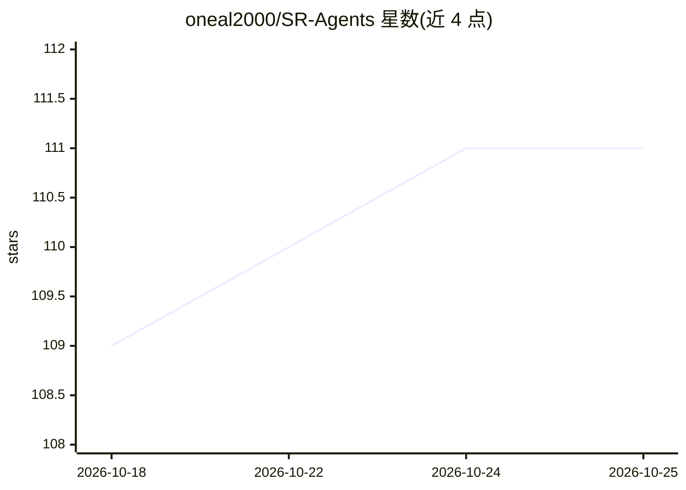

# oneal2000/SR-Agents

⭐ 111 · Python · MIT · 推送 2026-07-02 · [GitHub](https://github.com/oneal2000/SR-Agents) · [官网](https://sr-agents.github.io/) · 组织维护

**技能检索增强（SRA）基准与评测工具包：评估 LLM agent 的技能检索能力**

发布 SRA-Bench 基准与 SR-Agents 工具包，用于研究和评测 LLM agent 的技能检索增强（Skill Retrieval Augmentation）。基准含 5,400 个测试实例、26,262 个技能的检索语料，覆盖 6 个数据集；工具包提供 BM25/TF-IDF/BGE/Contriever/混合/LLM 重排等检索方法与 5 种技能使用方法，通过 retrieve→infer→evaluate 三阶段 CLI 管线评测。推理依赖 OpenAI 兼容端点（含 vLLM/SGLang/Ollama 等），需 Python 3.10–3.12。面向做 agent 技能检索研究的科研人员。

## 筛选速览

| 维度 | 判定 | 备注 |
|---|---|---|
| AI 角色 | `ai-ecosystem` | LLM/agent 周边工具 |
| 许可风险 | `permissive` | MIT |
| 部署形态 | `library` | 以包/库形式分发 |
| 模型依赖 | local-ok | 支持本地模型 |
| 硬件要求 | — | 无带数字的原话,不猜 |
| 安装摩擦 | `low` | 无编译、无系统依赖或容器化 |
| 成熟度 | — | 结构信号不足 |

## 能力要点

- SRA-Bench：5,400 实例 + 26,262 技能语料，覆盖 6 个任务族
- 6 种技能检索方法（BM25、BGE、混合检索、LLM 重排等）
- retrieve→infer→evaluate 三阶段 CLI，各阶段可独立替换与断点续跑
- 支持任意 OpenAI 兼容端点（vLLM/SGLang/Ollama/本地服务器）

## 适用场景

- 评测 agent 从大规模技能库中检索与应用技能的能力
- 复现论文中的技能检索与技能使用对比实验
- 对比不同检索器和技能注入策略对下游任务准确率的影响

## 场景标签

`模型评测` `RAG` · 领域:评测与运维

## 证据(README 行号)

> L23:  This repository releases SRA-Bench and SR-Agents, providing data, baselines, and evaluation pipelines for research
> L69: A research toolkit and baseline family for building and evaluating skill-retrieval-augmented agents:

## 星数曲线

2026-10-18 109 → 2026-10-25 111（+2）

---
*卡片 v1 · prompt 1.4 · 生成 2026-10-23 · 置信度 high · 依据 README sha `7dbca8ebb0a1` · [字段定义](../../DATASET.md)*
