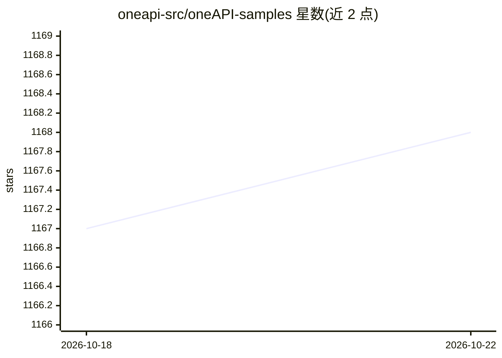

# oneapi-src/oneAPI-samples

⭐ 1,168 · C++ · MIT · 推送 2026-07-28 · [GitHub](https://github.com/oneapi-src/oneAPI-samples) · [官网](https://oneapi-src.github.io/oneAPI-samples/) · 组织维护

**Intel oneAPI 工具链官方代码示例集合，覆盖 CPU/GPU/FPGA**

Intel 官方维护的 oneAPI Toolkits 示例仓库：按 DirectProgramming（C++/C++SYCL/Fortran）、Libraries、Tools 等类别组织示例，配套可搜索过滤的 oneAPI Samples Catalog（按语言、专长级别、目标设备筛选）。获取方式为 git clone 或下载 ZIP，也可按 tag 获取与旧版工具链对应的示例。仓库在 Ubuntu 22.04.3、Xeon Platinum 8468V 与 Data Center GPU Max 1100 上做过平台验证，示例代码以 MIT 许可发布。

## 筛选速览

| 维度 | 判定 | 备注 |
|---|---|---|
| AI 角色 | `ai-knowledge` | 知识聚合/清单类 |
| 许可风险 | `permissive` | MIT |
| 部署形态 | `None` |  |
| 模型依赖 | — | README 未给出锁定关系 |
| 硬件要求 | — | 无带数字的原话,不猜 |
| 安装摩擦 | `low` | 无编译、无系统依赖或容器化 |
| 成熟度 | — | 结构信号不足 |

## 能力要点

- 按 DirectProgramming/Libraries/Tools 等类别组织的示例库
- 支持按 tag 获取对应旧版工具链的示例
- 在 Xeon 与 Data Center GPU Max 上做过平台验证
- 代码以 MIT 许可发布

## 适用场景

- 学习 oneAPI 的 CPU/GPU/FPGA 异构编程入门
- 以 Simple Add/Vector Add 示例作为项目起点
- 查找与已安装工具链版本匹配的示例代码

## 场景标签

 · 领域:异构计算/开发工具

## 证据(README 行号)

> L3: The oneAPI-samples repository contains samples for the Intel® oneAPI Toolkits.
> L52: | the basics of writing, compiling, and building programs for CPUs and GPUs |Simple Add or Vector Add samples (You 
> L63: The oneAPI-sample repository is organized by high-level categories.

## 星数曲线

2026-10-18 1,167 → 2026-10-22 1,168（+1）

---
*卡片 v1 · prompt 1.4 · 生成 2026-10-21 · 置信度 high · 依据 README sha `efc9f157f52d` · [字段定义](../../DATASET.md)*
