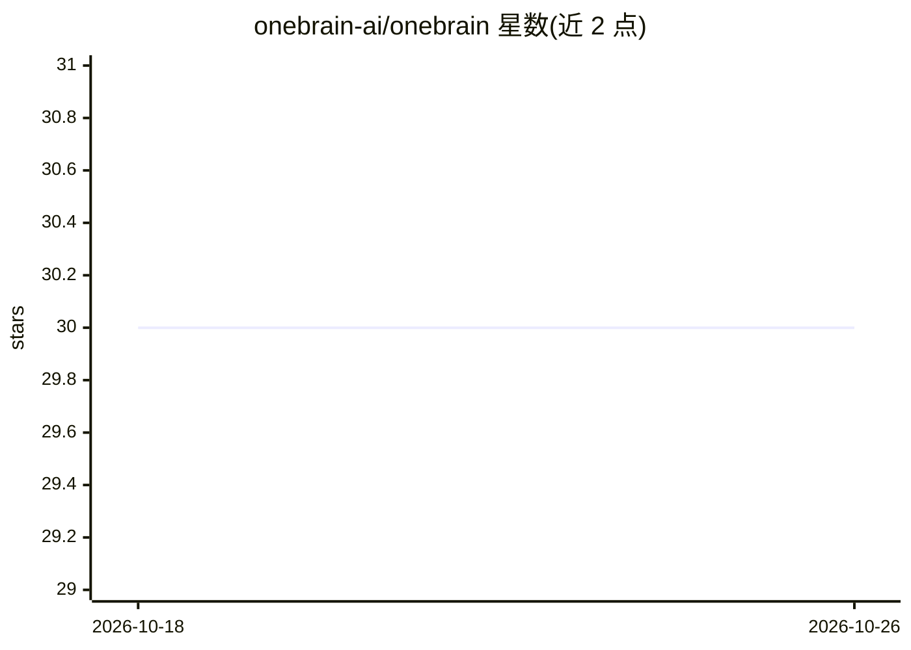

# onebrain-ai/onebrain

⭐ 30 · Shell · Apache-2.0 · 推送 2026-08-28 · [GitHub](https://github.com/onebrain-ai/onebrain) · [官网](https://onebrain.run) · 组织维护

**给 AI 编码助手的持久记忆与技能扩展层**

OneBrain 是开源的 AI OS 层（MIT/Apache-2.0），扩展 Claude Code、Gemini CLI、Codex、Qwen 等 AI harness：提供跨 harness 的持久记忆（Working/Episodic/Semantic/Knowledge/Archive 五层 Markdown vault）、31 个技能命令（/braindump、/research、/distill 等）、个人校准与 OS 级定时调度（launchd/Task Scheduler/systemd），可经 Telegram 接收简报。由插件（Rust 编写的 onebrain-cli 工具链，含 lex+vector 混合搜索、checkpoint、MCP 服务）与插件层组成，数据为本地 Markdown。跨机器同步功能标记为 planned。

## 筛选速览

| 维度 | 判定 | 备注 |
|---|---|---|
| AI 角色 | `ai-ecosystem` | LLM/agent 周边工具 |
| 许可风险 | `permissive` | Apache-2.0 |
| 部署形态 | `library` | 以包/库形式分发 |
| 模型依赖 | — | README 未给出锁定关系 |
| 硬件要求 | — | 无带数字的原话,不猜 |
| 安装摩擦 | `low` | 无编译、无系统依赖或容器化 |
| 成熟度 | — | 结构信号不足 |

## 能力要点

- 跨 Claude Code/Gemini CLI/Codex/Qwen 的持久记忆，本地 Markdown vault 为事实源
- 31 个 vault 感知技能命令，按 INPUT/PROCESS/RECALL/MAINTAIN 四阶段组织
- onebrain-cli 原生 Rust 工具链：混合 lex+vector 搜索、OS 级 cron 调度、checkpoint、MCP 服务
- 内置 Web UI 与 Telegram 移动端简报

## 适用场景

- 在不同 AI 编码助手间切换时保留记忆、偏好与项目上下文
- 把会话笔记、研究与决策沉淀为可检索的 Markdown 知识库
- 定时生成晨间摘要与日常简报并推送到 Telegram

## 场景标签

`Agent 记忆` `知识库管理` · 领域:Agent 开发

## 证据(README 行号)

> L11:  OneBrain is a free, open-source AI OS layer: persistent memory, 31 skills, scheduled skills that report to your va
> L55: OneBrain doesn't compete with Claude Code, Gemini CLI, or any other AI harness — **it extends them**. Whichever har
> L61: |01|**OneBrain**|OS layer (plugin + CLI)|31 skills · lifecycle hooks · local vault sync · indexing · checkpoints · 

## 星数曲线

2026-10-18 30 → 2026-10-26 30（+0）

---
*卡片 v1 · prompt 1.4 · 生成 2026-10-26 · 置信度 high · 依据 README sha `e44c865b6c17` · [字段定义](../../DATASET.md)*
