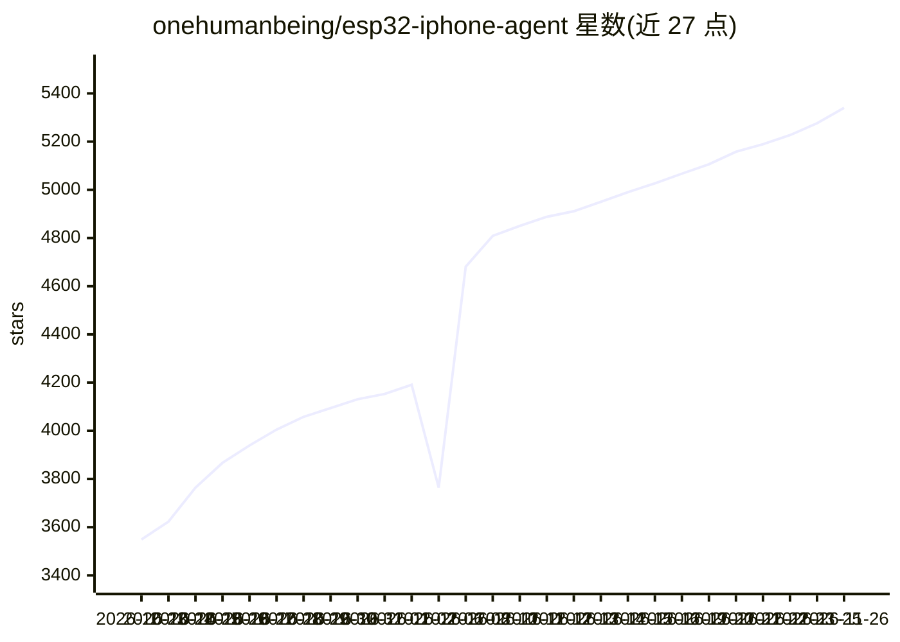

# onehumanbeing/esp32-iphone-agent

⭐ 5,340 · Swift · MIT · 推送 2026-11-25 · [GitHub](https://github.com/onehumanbeing/esp32-iphone-agent) · [官网](https://manina.ai?ref=github) · 个人维护 · 中文 README

**用 $7 ESP32 让 AI 视觉模型操控真实 iPhone 的开源硬件方案**

以 Seeed XIAO ESP32S3 板作眼睛与手机：板子作为 AirPlay 接收器接收屏幕 H.264 流并转发给 iPhone 上的 Agent 应用，应用解码后将截图发给任意 OpenAI 兼容视觉模型，由 planner/actor 通过 USB/蓝牙 HID 模拟鼠标键盘完成点击、滑动、输入等操作。提供 TestFlight 应用、浏览器一键刷固件、四步引导设置，并可通过 esp32agent CLI（MCP server）接入 Claude Code/Cursor 等编码代理。无需越狱、无需常开电脑；要求 iOS 16.4+，免费模型线路共享可能返回 503。

## 筛选速览

| 维度 | 判定 | 备注 |
|---|---|---|
| AI 角色 | `ai-native` | 本体是模型或模型工具 |
| 许可风险 | `permissive` | MIT |
| 部署形态 | `library` | 以包/库形式分发 |
| 模型依赖 | local-ok | 支持本地模型 |
| 硬件要求 | — | 无带数字的原话,不猜 |
| 安装摩擦 | `low` | 无编译、无系统依赖或容器化 |
| 成熟度 | `idea` | |

## 能力要点

- AirPlay 投屏做眼睛、USB/蓝牙 HID 做手，无需越狱或常驻电脑
- 支持任意 OpenAI 兼容视觉端点，可分别设置 planner 与 actor 模型
- esp32agent CLI 提供 MCP server，可由 Claude Code、Cursor 等驱动
- 运行全程留存在手机上，可逐步回放并导出 trace 供其他 agent 分析

## 适用场景

- 让 AI 代理自动完成 iPhone 上的日常应用操作
- 把 iPhone 作为 MCP 服务器接给编码代理远程操控
- 自动化测试或演示场景中无人值守跑手机任务

## 场景标签

`GUI 自动化` · 领域:效率与自动化

## 证据(README 行号)

> L96: - **Brain — the app.** The app decodes the stream, sends screenshots to any OpenAI-compatible vision model, and run
> L186: The `esp32agent` CLI (npm, `npx -y esp32agent mcp`) is an MCP server, so a coding agent on your computer can see

## 星数曲线

2026-10-23 3,549 → 2026-11-26 5,340（+1,791）

---
*卡片 v1 · prompt 1.4 · 生成 2026-11-26 · 置信度 high · 依据 README sha `1f8f9924062e` · [字段定义](../../DATASET.md)*
