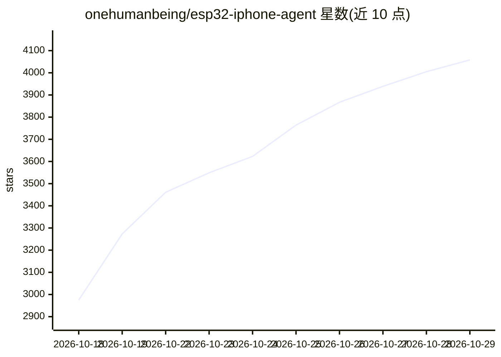

# onehumanbeing/esp32-iphone-agent

⭐ 4,058 · C · MIT · 推送 2026-10-28 · [GitHub](https://github.com/onehumanbeing/esp32-iphone-agent) · [官网](https://handsy.tech?ref=github) · 个人维护 · 中文 README

**用 ESP32-S3 让视觉模型操控真实 iPhone 的 agent 套件**

由 ESP32-S3 开发板固件与 iOS 应用组成：开发板充当 AirPlay 接收器（屏幕镜像）与 USB HID 鼠标键盘，iPhone 上的应用解码画面、调用任意 OpenAI 兼容视觉模型，运行 planner/actor 执行点击、滑动、输入等操作，实现自然语言驱动的手机自动化。支持运行回放与轨迹导出。限制：BLE 带宽约 300-500 kbps、镜像 480×1040 ≤5 fps；部分屏幕（锁屏密码、Apple Pay、DRM 视频）无法镜像；键盘仅 ASCII。需 Mac+Xcode 一次性烧录构建，免费 Apple ID 可签名（每 7 天重签）。

## 筛选速览

| 维度 | 判定 | 备注 |
|---|---|---|
| AI 角色 | `ai-native` | 本体是模型或模型工具 |
| 许可风险 | `permissive` | MIT |
| 部署形态 | `None` |  |
| 模型依赖 | local-ok | 支持本地模型 |
| 硬件要求 | — | 无带数字的原话,不猜 |
| 安装摩擦 | `low` | 无编译、无系统依赖或容器化 |
| 成熟度 | — | 结构信号不足 |

## 能力要点

- 开发板即 AirPlay 接收器与 USB HID 鼠标键盘，无需电脑与越狱
- 任意 OpenAI 兼容视觉端点可选模型，可分别设置 planner 与 actor 模型
- 指针校准与丢失链路后从同一步恢复
- 运行记录逐步回放，可批量导出轨迹供其他 agent 分析

## 适用场景

- 让 AI 代我按自然语言指令操作自己的 iPhone 应用
- 自动化重复性手机操作并回放审查每一步
- 导出 agent 操作轨迹用于分析或二次处理

## 场景标签

`GUI 自动化` · 领域:效率与自动化

## 证据(README 行号)

> L36: iPhone ──Screen Mirroring (Wi-Fi)──▶ ESP32-S3: AirPlay receiver ──BLE──▶ ESP32 Agent app (same iPhone)
> L46: - **Brain — the app.** The app decodes the stream, sends screenshots to any OpenAI-compatible vision model, and run

## 星数曲线

2026-10-18 2,975 → 2026-10-29 4,058（+1,083）

---
*卡片 v1 · prompt 1.4 · 生成 2026-10-20 · 置信度 high · 依据 README sha `9dcd201e92df` · [字段定义](../../DATASET.md)*
