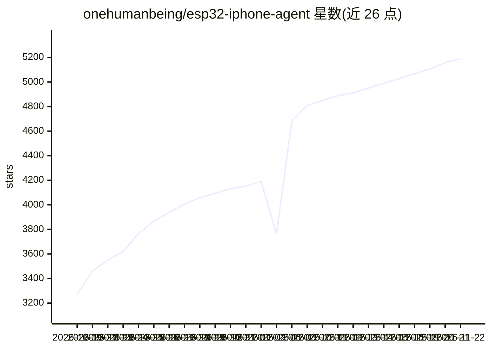

# onehumanbeing/esp32-iphone-agent

⭐ 5,189 · Swift · MIT · 推送 2026-11-21 · [GitHub](https://github.com/onehumanbeing/esp32-iphone-agent) · [官网](https://manina.ai?ref=github) · 个人维护 · 中文 README

**用 $7 ESP32 让视觉模型操控真实 iPhone 的 AI Agent**

硬件+应用组合：ESP32-S3 开发板作为 AirPlay 接收端获取 iPhone 屏幕的 H.264 流并转发给 iOS 上的 ESP32 Agent 应用，应用将截图发送至任意 OpenAI 兼容视觉模型，由 planner/actor 生成点击、滑动、输入等动作，再通过 USB/蓝牙 HID 鼠标键盘机制执行；需要开启 AssistiveTouch，支持断链暂停恢复、指针校准与运行回放导出。提供 TestFlight 安装、浏览器烧录固件、npm 发布的 MCP server CLI，以及 Claude Code/Cursor 插件接入方式。要求 iOS 18+，免越狱、免开发者账号。

## 筛选速览

| 维度 | 判定 | 备注 |
|---|---|---|
| AI 角色 | `ai-native` | 本体是模型或模型工具 |
| 许可风险 | `permissive` | MIT |
| 部署形态 | `library` | 以包/库形式分发 |
| 模型依赖 | local-ok | 支持本地模型 |
| 硬件要求 | — | 无带数字的原话,不猜 |
| 安装摩擦 | `low` | 无编译、无系统依赖或容器化 |
| 成熟度 | — | 结构信号不足 |

## 能力要点

- AirPlay 取屏 + USB/蓝牙 HID 执行的 iPhone 闭环操控架构
- 支持任意 OpenAI 兼容视觉端点，可分别配置 planner 与 actor 模型
- 每次运行可回放并导出截图/动作轨迹供其他 agent 分析
- esp32agent CLI 作为 MCP server，可被编码 agent 驱动

## 适用场景

- 让 AI 自动在真实 iPhone 上完成 App 内操作任务
- 把 iPhone 接入 Claude Code 或 Cursor 作为可操控设备
- 无需 Mac 与开发者账号的 iPhone 自动化实验

## 场景标签

`GUI 自动化` · 领域:效率与自动化

## 证据(README 行号)

> L89: - **Brain — the app.** The app decodes the stream, sends screenshots to any OpenAI-compatible vision model, and run
> L90:  a planner and an actor: tap, swipe, draw, type, press keys, go home, finish. It runs in the background while it
> L91:  works; the Dynamic Island shows what it is doing.

## 星数曲线

2026-10-19 3,273 → 2026-11-22 5,189（+1,916）

---
*卡片 v1 · prompt 1.4 · 生成 2026-11-22 · 置信度 high · 依据 README sha `e44fe0d9bff5` · [字段定义](../../DATASET.md)*
