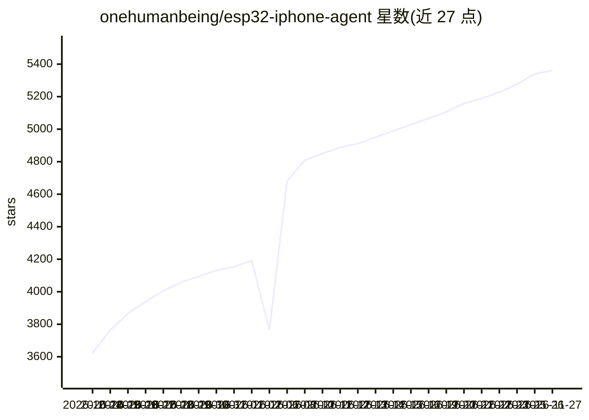

# onehumanbeing/esp32-iphone-agent

⭐ 5,361 · Swift · MIT · 推送 2026-11-26 · [GitHub](https://github.com/onehumanbeing/esp32-iphone-agent) · [官网](https://manina.ai?ref=github) · 个人维护

**用 $7 ESP32 板让 AI 模型操作真实 iPhone（看屏+点击输入）**

开源的 iPhone 物理操作代理系统：ESP32-S3 板作为 AirPlay 接收端获取屏幕画面（H.264 透传），同时充当 USB/蓝牙 HID 鼠标键盘执行动作；iPhone 上的 App 解码画面、发送截图给任意 OpenAI 兼容视觉模型，运行 planner/actor 循环完成点击、滑动、输入等操作。无需越狱、无需 Mac 常驻、无需开发者账号，通过浏览器烧录固件、TestFlight 安装 App，四步引导设置。另提供 esp32agent CLI 作为 MCP 服务器，可从 Claude Code、Cursor 等编码代理驱动手机。运行依赖手机蜂窝数据或共享路由器 Wi-Fi。

## 筛选速览

| 维度 | 判定 | 备注 |
|---|---|---|
| AI 角色 | `ai-native` | 本体是模型或模型工具 |
| 许可风险 | `permissive` | MIT |
| 部署形态 | `library` | 以包/库形式分发 |
| 模型依赖 | local-ok | 支持本地模型 |
| 硬件要求 | — | 无带数字的原话,不猜 |
| 安装摩擦 | `low` | 无编译、无系统依赖或容器化 |
| 成熟度 | — | 结构信号不足 |

## 能力要点

- ESP32-S3 一板兼任 AirPlay 眼睛与 USB/蓝牙 HID 手
- 支持任意 OpenAI 兼容视觉端点（云端 API 或自建服务器），可分别设置 planner 与 actor 模型
- 浏览器一键烧录，TestFlight 安装，无需越狱与开发者账号
- esp32agent CLI 提供 MCP 服务器，供编码代理驱动 iPhone

## 适用场景

- 让 AI 独立完成 iPhone 上的应用操作任务（如 Duolingo 课程）
- 通过 Claude Code/Cursor 等 MCP 客户端远程控制手机
- 批量导出操作轨迹供另一个 agent 复盘分析

## 场景标签

`GUI 自动化` · 领域:效率与自动化

## 证据(README 行号)

> L107: - **Brain — the app.** The app decodes the stream, sends screenshots to any OpenAI-compatible vision model, and ru
> L139: |**Vision model**|Any OpenAI-compatible chat API that accepts images: a cloud API or your own server.|

## 星数曲线

2026-10-24 3,623 → 2026-11-27 5,361（+1,738）

---
*卡片 v1 · prompt 1.4 · 生成 2026-11-27 · 置信度 high · 依据 README sha `8800c506ab10` · [字段定义](../../DATASET.md)*
