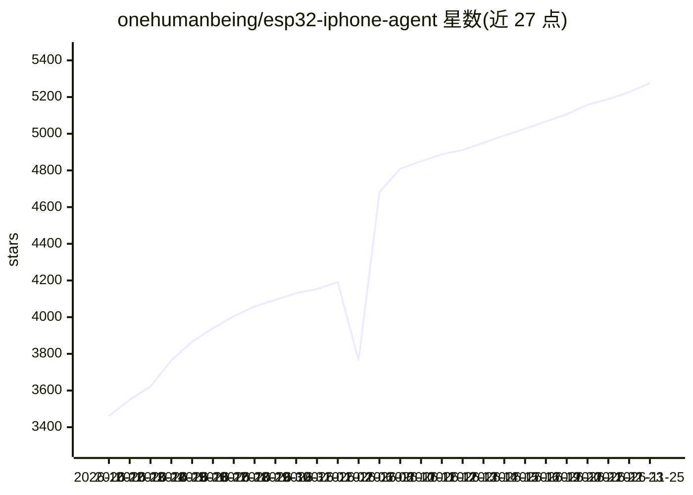

# onehumanbeing/esp32-iphone-agent

⭐ 5,276 · Swift · MIT · 推送 2026-11-23 · [GitHub](https://github.com/onehumanbeing/esp32-iphone-agent) · [官网](https://manina.ai?ref=github) · 个人维护 · 中文 README

**用 $7 ESP32 板让 AI 模型操作真实 iPhone**

通过 ESP32-S3 板让 AI 视觉模型控制真实 iPhone：屏幕经 AirPlay 镜像到板载热点并转发给手机上的 App，App 解码后将截图发给任意 OpenAI 兼容视觉模型，由 planner/actor 生成点击、滑动、输入等动作，经 USB/蓝牙 HID 鼠标键盘执行；指针自动校准、断连暂停恢复、每步可回放并导出 trace。无需越狱、开发者账号或常驻电脑；iOS 16.4+，App 经 TestFlight 分发，也提供 npm CLI 以 MCP 方式供编程 agent 调用。

## 筛选速览

| 维度 | 判定 | 备注 |
|---|---|---|
| AI 角色 | `ai-native` | 本体是模型或模型工具 |
| 许可风险 | `permissive` | MIT |
| 部署形态 | `library` | 以包/库形式分发 |
| 模型依赖 | local-ok | 支持本地模型 |
| 硬件要求 | — | 无带数字的原话,不猜 |
| 安装摩擦 | `low` | 无编译、无系统依赖或容器化 |
| 成熟度 | — | 结构信号不足 |

## 能力要点

- AirPlay 接收 + USB/蓝牙 HID 输入实现无越狱 iPhone 操作
- 支持任意 OpenAI 兼容视觉端点，可分别配置 planner 与 actor 模型
- esp32agent CLI 作为 MCP server，可被 Claude Code/Cursor 等调用
- 运行记录逐帧回放并支持导出 trace 供其他 agent 分析

## 适用场景

- 让 AI 自动完成 iPhone 上的应用操作任务
- 为 computer-use 研究采集带截图与动作的真实操作轨迹
- 通过 MCP 让本机编程 agent 远程驱动一台 iPhone

## 场景标签

`GUI 自动化` `编码 Agent` · 领域:效率与自动化

## 证据(README 行号)

> L3:  An AI agent uses a real iPhone like a person.
> L89: - **Brain — the app.** The app decodes the stream, sends screenshots to any OpenAI-compatible vision model, and run
> L222: - Any OpenAI-compatible vision endpoint works (vLLM, SGLang, llama.cpp, Ollama, cloud APIs). The app lists the

## 星数曲线

2026-10-22 3,461 → 2026-11-25 5,276（+1,815）

---
*卡片 v1 · prompt 1.4 · 生成 2026-11-24 · 置信度 high · 依据 README sha `ba93866fa9cf` · [字段定义](../../DATASET.md)*
