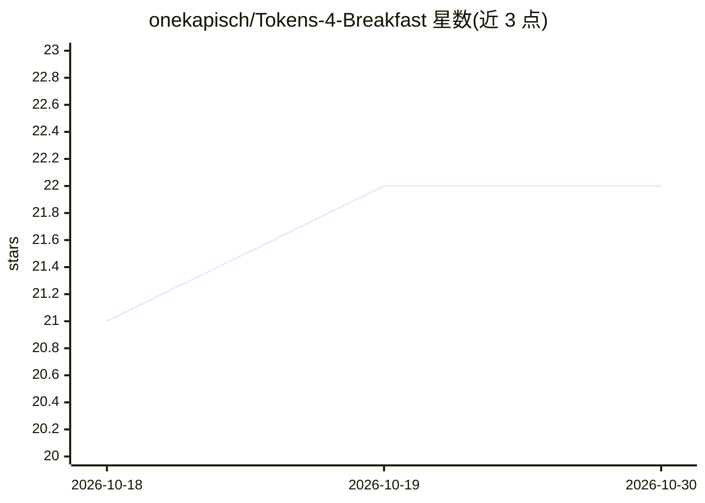

# onekapisch/Tokens-4-Breakfast

⭐ 22 · NOASSERTION · 推送 2026-10-04 · [GitHub](https://github.com/onekapisch/Tokens-4-Breakfast) · [官网](https://www.tokens4breakfast.app) · 组织维护

**Mac 菜单栏追踪 11 家 AI 工具用量、花费与限额的商用闭源应用**

macOS 菜单栏应用，聚合 Claude Code、Cursor、Codex、Copilot、OpenAI 等 11 个 AI 服务商的用量、API 等价花费、订阅成本与速率限额，含 5 小时/每周限额的配速标记、燃烧率预测、80/95/100% 告警与 Focus Mode 预算。数据存本地 SQLite，无遥测，密钥存 Keychain，出站请求有审计日志。闭源商业化：仓库仅托管文档与 issue；免费版限 1 个服务商，Pro 一次性 $14.99 解锁全部，Gemini 尚未支持。

## 筛选速览

| 维度 | 判定 | 备注 |
|---|---|---|
| AI 角色 | `ai-ecosystem` | LLM/agent 周边工具 |
| 许可风险 | `none` | NOASSERTION |
| 部署形态 | `None` |  |
| 模型依赖 | — | README 未给出锁定关系 |
| 硬件要求 | — | 无带数字的原话,不猜 |
| 安装摩擦 | `low` | 无编译、无系统依赖或容器化 |
| 成熟度 | — | 结构信号不足 |

## 能力要点

- 11 个服务商的用量/花费/限额聚合到菜单栏
- 限额配速标记、燃烧率预测与 80/95/100% 告警
- 本地 SQLite 存储、无遥测、API 密钥存 macOS Keychain
- 出站请求隐私审计日志（host/reason/time）

## 适用场景

- 在菜单栏随时查看各 AI 工具的剩余限额与花费
- 避免在 agent 任务中途撞上速率限额
- 对比订阅计划与按量付费的 API 等价价值

## 场景标签

 · 领域:开发者工具/AI 成本监控

## 证据(README 行号)

> L3: **AI spend, tokens and rate limits across 11 providers, in one private Mac menu bar app.**
> L26: Tokens 4 Breakfast keeps both numbers in your menu bar while you work: what your usage is worth, what your subscrip
> L74: 11 providers connect. 8 of them report real spend; Claude Web and Grok report live rate limits only, and DeepSeek r

## 星数曲线

2026-10-18 21 → 2026-10-30 22（+1）

---
*卡片 v1 · prompt 1.4 · 生成 2026-10-27 · 置信度 high · 依据 README sha `3364771363a6` · [字段定义](../../DATASET.md)*
