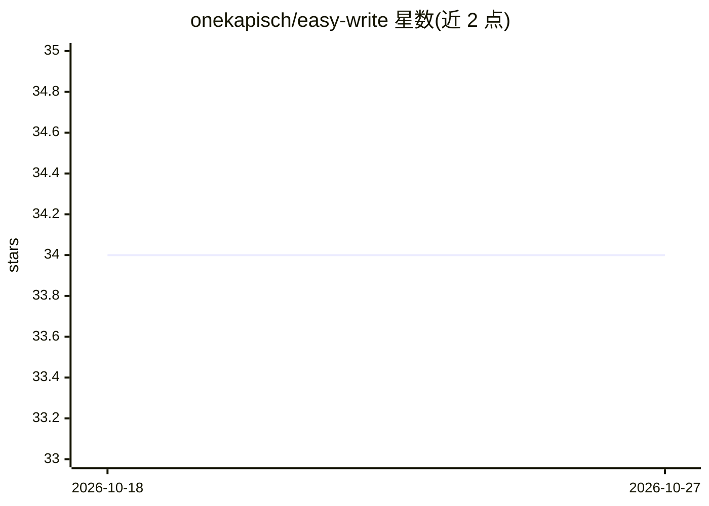

# onekapisch/easy-write

⭐ 34 · Swift · MIT · 推送 2026-10-24 · [GitHub](https://github.com/onekapisch/easy-write) · [官网](https://www.onekapisch.com/products/easy-write/) · 个人维护

**Mac 菜单栏翻译改写工具：快捷键就地替换文本，本地模型驱动**

面向 macOS 26+ Apple Silicon 用户的就地翻译与改写应用：在任意应用中选中文本、按快捷键，文本即被原位替换为指定语气的译文（德语 Sie/du、法语 vous/tu 等正式/非正式区分）。由 Apple Intelligence 端侧模型驱动，无账户、无 API key、无云端，文本不出本机。支持 13 种语言、自定义动作、术语表、本地历史（默认关闭）。需授权 Accessibility 权限，安装方式为签名公证的 DMG 或源码构建，Homebrew 未提供。

## 筛选速览

| 维度 | 判定 | 备注 |
|---|---|---|
| AI 角色 | `ai-native` | 本体是模型或模型工具 |
| 许可风险 | `permissive` | MIT |
| 部署形态 | `desktop` | 安装包/桌面程序 |
| 模型依赖 | — | README 未给出锁定关系 |
| 硬件要求 | — | 无带数字的原话,不猜 |
| 安装摩擦 | `low` | 无编译、无系统依赖或容器化 |
| 成熟度 | — | 结构信号不足 |

## 能力要点

- 选中文本后快捷键原位替换，支持正式/非正式语气区分
- 完全依赖 Apple Intelligence 端侧模型，无账户无 API key
- Easy Write Bar（⌥⌘K）支持任意指令一次性运行，结果流式预览
- 支持 13 种语言与自定义改写动作，可分享为链接

## 适用场景

- 写外语邮件/消息时一键翻译并原位替换，省去复制粘贴
- 按对话对象切换正式与非正式语气（如德语 Sie/du）
- 在不可编辑的文本上用阅读卡片模式翻译成母语
- 用自定义动作修正语法、缩短或礼貌化回复

## 场景标签

`AI 写作` · 领域:内容生成

## 证据(README 行号)

> L9: grammar, make it shorter, reply politely. Powered entirely by Apple's **on-device** model (Apple
> L41: **Easy Write uses the AI already built into macOS 26** — so it's private *and* there's nothing to set
> L163: Your text never leaves your Mac. The model runs locally; there is no analytics, no telemetry, and no

## 星数曲线

2026-10-18 34 → 2026-10-27 34（+0）

---
*卡片 v1 · prompt 1.4 · 生成 2026-10-25 · 置信度 high · 依据 README sha `82ac69ef8198` · [字段定义](../../DATASET.md)*
