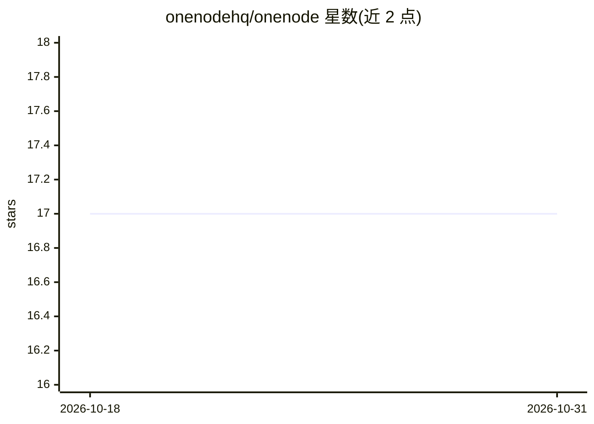

# onenodehq/onenode

⭐ 17 · TypeScript · MIT · 推送 2026-02-28 · [GitHub](https://github.com/onenodehq/onenode) · [官网](https://www.onenode.ai) · 组织维护

**多模态语义搜索编排框架：统一接入存储/向量库/LLM**

OneNode Community Edition（MIT，公测阶段）是语义搜索框架，作为编排层将 MongoDB、Pinecone、S3 兼容存储（MinIO）、Redis 与 LLM（OpenAI/Anthropic）整合为统一 API，支持文本与图像的语义搜索、自动查询路由与后台异步处理。通过 Docker Compose 本地部署全部服务，提供直接 API 端点；社区版不兼容托管版 SDK。需 Docker、OpenAI 与 Pinecone API Key。

## 筛选速览

| 维度 | 判定 | 备注 |
|---|---|---|
| AI 角色 | `ai-ecosystem` | LLM/agent 周边工具 |
| 许可风险 | `permissive` | MIT |
| 部署形态 | `self-host` | docker 或自建部署 |
| 模型依赖 | — | README 未给出锁定关系 |
| 硬件要求 | — | 无带数字的原话,不猜 |
| 安装摩擦 | `low` | 无编译、无系统依赖或容器化 |
| 成熟度 | `idea` | |

## 能力要点

- 统一 API 编排 MongoDB/Pinecone/MinIO/Redis/LLM
- 文本与图像多模态语义搜索与自动查询路由
- Docker Compose 一键本地部署全套服务
- 内置 OpenAI/Anthropic 等 LLM 提供商连接

## 适用场景

- 基于自有数据构建 RAG 问答应用
- 电商商品图文混合搜索
- 跨文档与图片的内容检索管理

## 场景标签

`语义搜索` · 领域:知识与检索

## 证据(README 行号)

> L7: OneNode Community Edition is a semantic search framework that acts as a central orchestration layer, seamlessly inte
> L20: - **Central Hub**: One API to orchestrate MongoDB, Pinecone, S3-compatible storage, Redis, and LLMs
> L65: OneNode acts as an intelligent orchestration layer that automatically routes operations to the right backend servic

## 星数曲线

2026-10-18 17 → 2026-10-31 17（+0）

---
*卡片 v1 · prompt 1.4 · 生成 2026-10-29 · 置信度 high · 依据 README sha `8f4a2b261fb2` · [字段定义](../../DATASET.md)*
