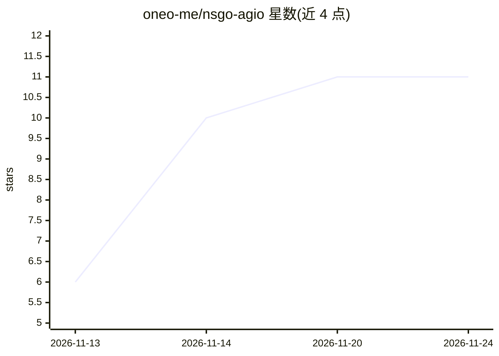

# oneo-me/nsgo-agio

⭐ 11 · Go · MIT · 推送 2026-11-23 · [GitHub](https://github.com/oneo-me/nsgo-agio) · [官网](https://oneo-me.github.io/nsgo-agio/) · 组织维护 · 中文 README

**NSGo 应用的 agent 核心：在手机与桌面运行并展示编码 agent**

Go 编写的库与应用两部分：库内含各编码 agent CLI 的驱动、可在 macOS/Windows/Linux 运行它们的主机、供其他进程或手机访问的 wire 协议，以及手机/桌面视图，统一在一个中立 API 之后；`cmd/agio` 应用演示该核心，提供项目任务、agent 与模型设置、配色、通知与自动更新。支持单进程运行或作为服务器与客户端部署，需 Go 1.27 及登录 shell PATH 上的 agent CLI。

## 筛选速览

| 维度 | 判定 | 备注 |
|---|---|---|
| AI 角色 | `ai-ecosystem` | LLM/agent 周边工具 |
| 许可风险 | `permissive` | MIT |
| 部署形态 | `None` |  |
| 模型依赖 | — | README 未给出锁定关系 |
| 硬件要求 | — | 无带数字的原话,不猜 |
| 安装摩擦 | `low` | 无编译、无系统依赖或容器化 |
| 成熟度 | — | 结构信号不足 |

## 能力要点

- 为多种编码 agent CLI（pi、Codex、Claude Code 等）提供驱动
- 单进程内运行或以 server/client 形式经 wire 协议访问
- 支持 macOS/Windows/Linux 的 arm64 与 x64，安装包可自动更新
- chatview.Conversation 可在应用自有布局中展示单个会话

## 适用场景

- 在自己的开发环境应用中集成多种编码 agent 的运行与展示
- 把 agent 任务投到手机或远程客户端上查看
- 以服务器形式在私有网络中托管 agent 会话

## 场景标签

`编码 Agent` · 领域:编码与开发

## 证据(README 行号)

> L12:  The agent core of NSGo apps: run coding agents (pi, Codex, Claude Code, Cursor, OpenCode, Grok Build, Antigravity,
> L18: - **A library.** Other NSGo apps build their own development environments on it: drivers for each agent CLI, a host

## 星数曲线

2026-11-13 6 → 2026-11-24 11（+5）

---
*卡片 v1 · prompt 1.4 · 生成 2026-11-19 · 置信度 high · 依据 README sha `c415360bd74c` · [字段定义](../../DATASET.md)*
