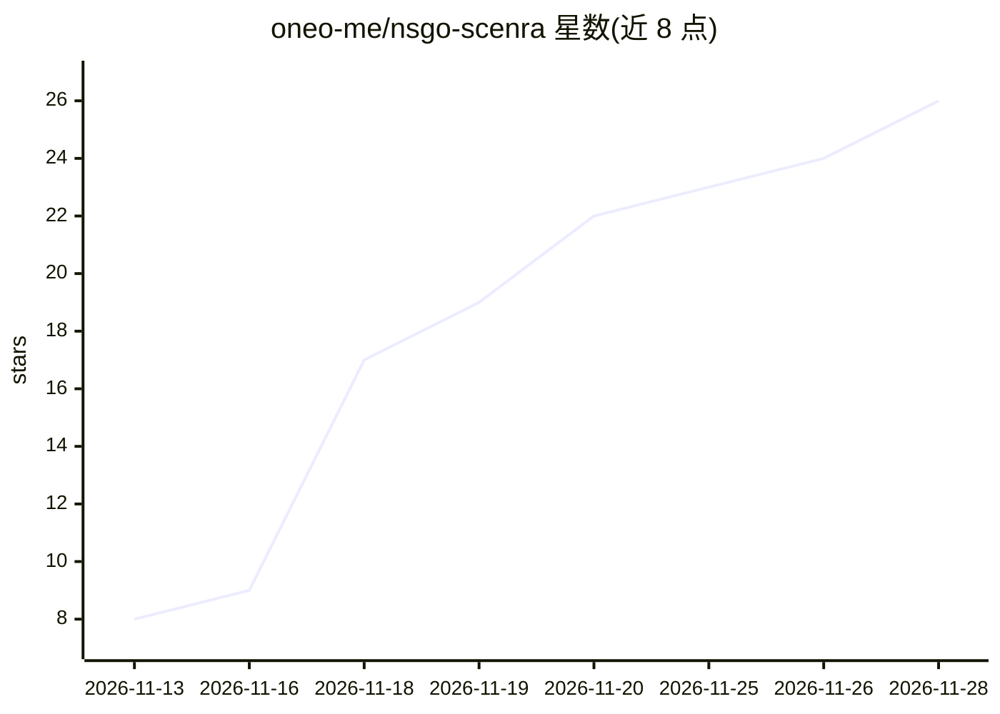

# oneo-me/nsgo-scenra

⭐ 26 · Go · MIT · 推送 2026-11-27 · [GitHub](https://github.com/oneo-me/nsgo-scenra) · [官网](https://oneo-me.github.io/nsgo-scenra/) · 个人维护 · 中文 README

**对话式设计桌面应用：AI 助手按你的确认绘制界面与流程图**

跨平台（macOS/Windows/Linux）的桌面应用与流程设计器：用户与已安装的编码代理（如 Claude Code、Codex、pi、CodeBuddy Code）对话，代理按其确认生成并绘制应用界面设计与流程图，保存为可读、可 diff、可手工编辑的纯文本 .scenra 文件。设计由盒、文本、图标、图像与 SVG 经 Tailwind CSS 类塑形，支持组件复用、播放原型交互、Git 变更行数显示；界面提供中英文。需 Go 从源码运行与构建，另提供 scenraview 包供其他 NSGo 应用嵌入编辑器。

## 筛选速览

| 维度 | 判定 | 备注 |
|---|---|---|
| AI 角色 | `ai-enhanced` | 去掉 AI 部分产品仍成立 |
| 许可风险 | `permissive` | MIT |
| 部署形态 | `None` |  |
| 模型依赖 | — | README 未给出锁定关系 |
| 硬件要求 | — | 无带数字的原话,不猜 |
| 安装摩擦 | `low` | 无编译、无系统依赖或容器化 |
| 成熟度 | — | 结构信号不足 |

## 能力要点

- 对话驱动 AI 助手生成界面设计与流程图，每轮撤销为一步
- 设计保存为纯文本 .scenra 文件，可读、diff、手工编辑
- 支持组件/变体复用与设计播放（点按跳转、关闭、切标签）
- 提供 scenraview 包与 flowfile 包，供其他应用嵌入编辑器与读写格式

## 适用场景

- 通过对话快速起草应用各屏幕与导航流程
- 在 Git 仓库中跟踪设计的文件级变更
- 让 AI 依据现有代码文件夹绘制代码工作流程图

## 场景标签

`AI 助手` · 领域:对话与助手

## 证据(README 行号)

> L27: - The assistant is a coding agent you have installed, such as Claude Code, Codex, pi or CodeBuddy Code: it asks wha
> L34: - Designs are plain-text `.scenra` files you can read, diff and edit by hand.

## 星数曲线

2026-11-13 8 → 2026-11-28 26（+18）

---
*卡片 v1 · prompt 1.4 · 生成 2026-11-18 · 置信度 high · 依据 README sha `b7c49558d441` · [字段定义](../../DATASET.md)*
