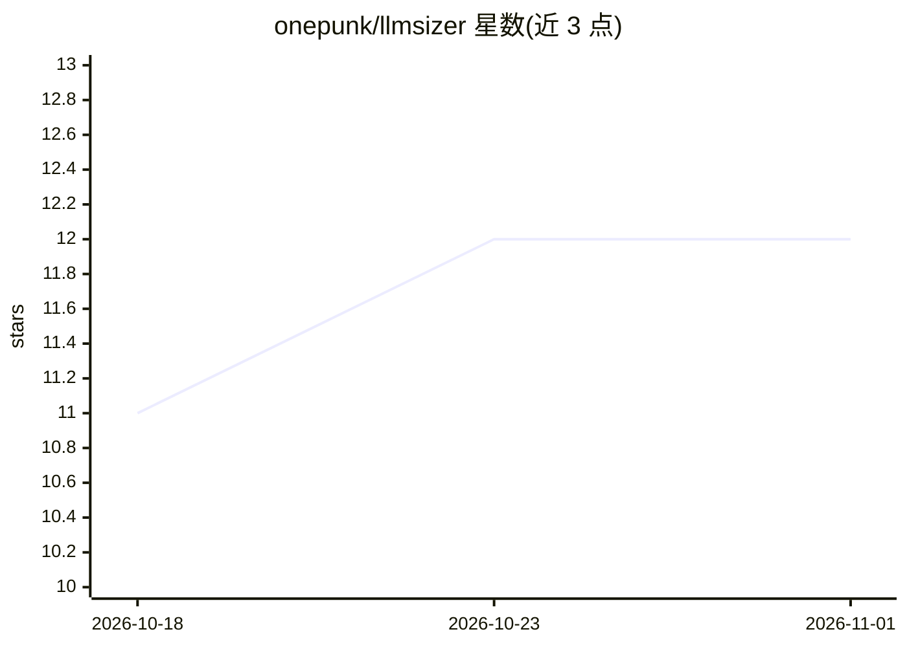

# onepunk/llmsizer

⭐ 12 · TypeScript · MIT · 推送 2026-10-26 · [GitHub](https://github.com/onepunk/llmsizer) · [官网](https://llmsizer.com) · 个人维护

**浏览器端检测 GPU 并估算哪些 LLM 能装进你的显存**

纯浏览器运行的静态 React SPA，无后端：通过 WebGL 检测本机 GPU，对 900+ 模型在 Q2_K 至 F16 各量化档位下估算显存占用，按 GPU 显存带宽预测 tokens/sec，并按质量、速度、适配度、上下文长度打分排序，给出 perfect/good/marginal/won't run 判定。支持多 GPU 建模（layer-split 与 tensor-parallel 两种策略，参照 llama.cpp/vLLM 的实际运行方式），模型数据库每周从 HuggingFace 自动更新。本地运行需 npm install && npm run dev。

## 筛选速览

| 维度 | 判定 | 备注 |
|---|---|---|
| AI 角色 | `ai-ecosystem` | LLM/agent 周边工具 |
| 许可风险 | `permissive` | MIT |
| 部署形态 | `library` | 以包/库形式分发 |
| 模型依赖 | — | README 未给出锁定关系 |
| 硬件要求 | — | 无带数字的原话,不猜 |
| 安装摩擦 | `low` | 无编译、无系统依赖或容器化 |
| 成熟度 | — | 结构信号不足 |

## 能力要点

- WebGL 检测 GPU，浏览器端完成全部计算，无需后端
- 900+ 模型按 Q2_K–F16 量化档位估算显存并预测 tokens/sec
- 多 GPU 建模支持 layer-split 与 tensor-parallel 策略，可选 NVLink/PCIe 互连
- 模型数据库每周从 HuggingFace 自动更新，AWQ/GPTQ/MLX/BNB 仓库按真实 safetensors 体积计算

## 适用场景

- 买卡或换卡前查哪些 LLM 能在我的显存里跑起来
- 对比不同量化档位下模型的占用和速度
- 多 GPU 系统规划 layer-split 或 tensor-parallel 方案

## 场景标签

 · 领域:LLM 硬件适配/选型工具

## 证据(README 行号)

> L9: - **Detects your GPU** via WebGL
> L12: - **Scores and ranks** 900+ models by quality, speed, fit, and context length
> L17: llmsizer models multi-GPU systems the way llama.cpp / vLLM actually run them:

## 星数曲线

2026-10-18 11 → 2026-11-01 12（+1）

---
*卡片 v1 · prompt 1.4 · 生成 2026-11-01 · 置信度 high · 依据 README sha `03262f91a432` · [字段定义](../../DATASET.md)*
