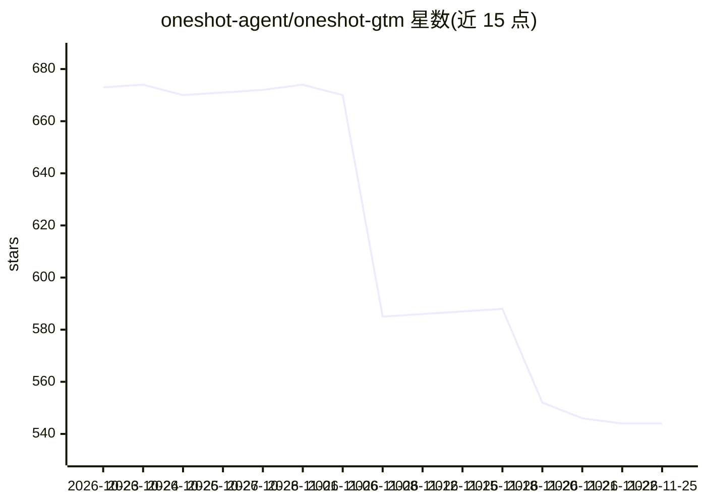

# oneshot-agent/oneshot-gtm

⭐ 544 · TypeScript · MIT · 推送 2026-11-21 · [GitHub](https://github.com/oneshot-agent/oneshot-gtm) · [官网](https://oneshot-gtm.com) · 组织维护

**面向技术创始人的外联 GTM agent：找人、起草、按次计费**

运行在本机的销售外联工具：终端 CLI 加本地 web 仪表盘，共用一个 SQLite 账本。它通过多种 finder 监听公开信号（发布、融资、GitHub star 等）寻找潜在客户，按 ICP 过滤并由用户批准后，用 LLM 结合调研与产品简介起草个性化首触消息与后续节奏；发送走用户自己的邮箱池与 LinkedIn 账号。每次付费调用留下签名回执，按调用计费；内置发送配额、机器文风 lint、重复防护等代码级限制。MIT 许可，需自备 LLM key。

## 筛选速览

| 维度 | 判定 | 备注 |
|---|---|---|
| AI 角色 | `ai-native` | 本体是模型或模型工具 |
| 许可风险 | `permissive` | MIT |
| 部署形态 | `None` |  |
| 模型依赖 | — | README 未给出锁定关系 |
| 硬件要求 | — | 无带数字的原话,不猜 |
| 安装摩擦 | `low` | 无编译、无系统依赖或容器化 |
| 成熟度 | — | 结构信号不足 |

## 能力要点

- finder 监听公开信号生成候选，ICP gate 过滤后由用户批准
- 每次付费调用生成签名回执，按结果计费可记录
- 代码级限制：新邮箱每日 10 封起步、机器文风 lint 拦截
- 本地 CLI + 本地仪表盘双入口，单一 SQLite 账本

## 适用场景

- 为尚未验证 PMF 的产品做小规模定向冷启动外联
- 监听融资、Launch HN 等信号自动找潜在客户并起草首封消息
- 多产品团队用 workspace 隔离线索、避免重复触达

## 场景标签

`AI 写作` `工作流自动化` · 领域:效率与自动化

## 证据(README 行号)

> L3: Outbound for founders who have not earned scale yet. It finds people, you approve them, it writes, you send.
> L25: It runs on your machine: a CLI and a local dashboard over one SQLite ledger. OneShot supplies the actions (research

## 星数曲线

2026-10-23 673 → 2026-11-25 544（-129）

---
*卡片 v1 · prompt 1.4 · 生成 2026-11-25 · 置信度 high · 依据 README sha `bb2d836a3e44` · [字段定义](../../DATASET.md)*
