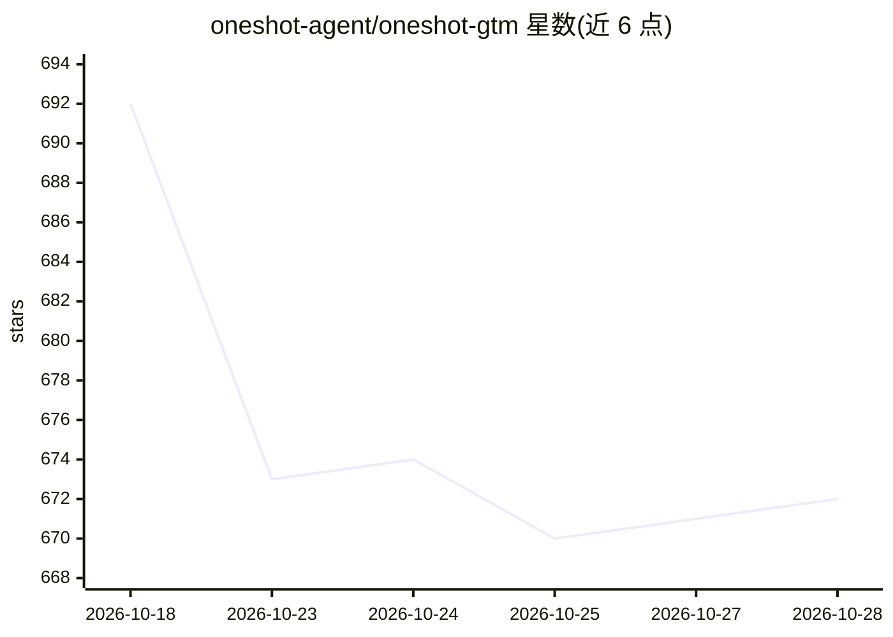

# oneshot-agent/oneshot-gtm

⭐ 672 · TypeScript · MIT · 推送 2026-10-28 · [GitHub](https://github.com/oneshot-agent/oneshot-gtm) · [官网](https://oneshot-gtm.com) · 组织维护

**面向技术创始人的出站销售 agent：CLI + 本地仪表盘，按结果付费**

运行在本机（Bun + SQLite 账本）的 GTM 出站销售工具，提供终端 CLI 与本地 Web 仪表盘两个界面。机制：Finder 监听公开信号（融资、发布、GitHub star 等）找人，ICP 门控过滤，人工批准后由 LLM 生成个性化首触邮件（用户自带 LLM key），经 OneShot SDK 执行邮件/LinkedIn/SMS 等动作并按调用计费。内置限制：首信不得约陌生人开会、机器写作 lint、新邮箱每日 10 封上限等。MIT 许可。

## 筛选速览

| 维度 | 判定 | 备注 |
|---|---|---|
| AI 角色 | `ai-native` | 本体是模型或模型工具 |
| 许可风险 | `permissive` | MIT |
| 部署形态 | `None` |  |
| 模型依赖 | — | README 未给出锁定关系 |
| 硬件要求 | — | 无带数字的原话,不猜 |
| 安装摩擦 | `low` | 无编译、无系统依赖或容器化 |
| 成熟度 | `idea` | |

## 能力要点

- Finder 监听公开信号（Show HN、融资、GitHub stars 等）按计划与花费上限找人
- ICP 门控过滤 + 人工批准队列，批准本身不发信
- 每次付费调用生成签名收据，单个回复花费可记账
- 内置发送限制：机器写作 lint、新邮箱 10 封/日逐步升至 50

## 适用场景

- 作为早期创始人寻找并联系符合 ICP 的潜在客户
- 批量生成但逐条审批个性化外联邮件与后续节奏
- 多产品线用独立工作区隔离话术与账本，共享联系人去重

## 场景标签

`AI 写作` · 领域:内容生成

## 证据(README 行号)

> L3: Outbound for founders who have not earned scale yet. It finds people, you approve them, it writes, you send.
> L20: - Each message opens with an offer specific to their firm, written from research and your product brief, in your vo
> L25: It runs on your machine: a CLI and a local dashboard over one SQLite ledger. OneShot supplies the actions (research

## 星数曲线

2026-10-18 692 → 2026-10-28 672（-20）

---
*卡片 v1 · prompt 1.4 · 生成 2026-10-21 · 置信度 mid · 依据 README sha `d87becdbd099` · [字段定义](../../DATASET.md)*
