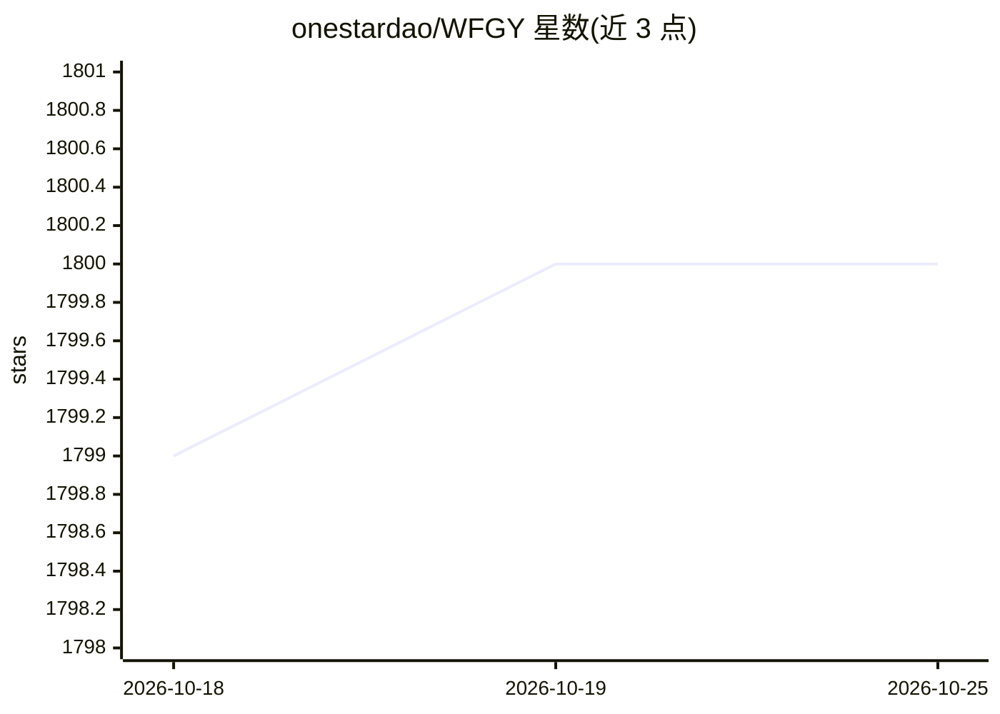

# onestardao/WFGY

⭐ 1,800 · Jupyter Notebook · NOASSERTION · 推送 2026-10-24 · [GitHub](https://github.com/onestardao/WFGY) · [官网](https://github.com/onestardao/WFGY) · 个人维护 · 中文 README

**面向结构化语言系统的协议层项目，分批开源 AI 执行协议组件**

WFGY 是一个分批发布的开源生态系统，定位为构建、调优、验证结构化语言系统的治理协议层。当前公开内容包括 Polaris Goal Compiler（可移植的人机执行协议，用于在构建前编译用户目标、分离事实与表达、阻止过早声称完成）、Problem Map 3.0（面向失效 RAG/agent 管线的调试路由 TXT、Global Debug Card 等）、带 SHA256 校验的公开证据包，以及 WFGY 3.0 TXT 包（下载后上传至 LLM 按 run/go 指令运行）。更深的引擎层与运行时结构宣布为后续分批发布。

## 筛选速览

| 维度 | 判定 | 备注 |
|---|---|---|
| AI 角色 | `ai-ecosystem` | LLM/agent 周边工具 |
| 许可风险 | `none` | NOASSERTION |
| 部署形态 | `None` |  |
| 模型依赖 | — | README 未给出锁定关系 |
| 硬件要求 | — | 无带数字的原话,不猜 |
| 安装摩擦 | `low` | 无编译、无系统依赖或容器化 |
| 成熟度 | `idea` | |

## 能力要点

- Polaris Goal Compiler：可粘贴进 AI 助手或 agent 规则文件的执行协议
- 公开证据包含原始输出、判定文件、token 记录与 SHA256 完整性记录
- Problem Map 3.0 提供 RAG/agent 管线的调试入口
- WFGY 3.0 TXT 包通过 SHA256 校验后可在 LLM 中按内置控制台运行

## 适用场景

- 为 AI 助手或 agent 工作流引入目标编译与验证协议
- RAG 或 agent 管线失效时查找调试路由
- 下载并核验实验证据包的完整性

## 场景标签

`LLM 可观测性` · 领域:评测与运维

## 证据(README 行号)

> L18: A governed protocol layer for building, tuning, verifying, and carrying structured language systems across sessions
> L81: **Polaris Goal Compiler** is a portable human-AI execution protocol for assistants, agents, and skill-based workflo
> L83: It helps AI systems avoid treating raw natural language as if it were already an executable task.

## 星数曲线

2026-10-18 1,799 → 2026-10-25 1,800（+1）

---
*卡片 v1 · prompt 1.4 · 生成 2026-10-21 · 置信度 mid · 依据 README sha `cfc77f2a2a29` · [字段定义](../../DATASET.md)*
