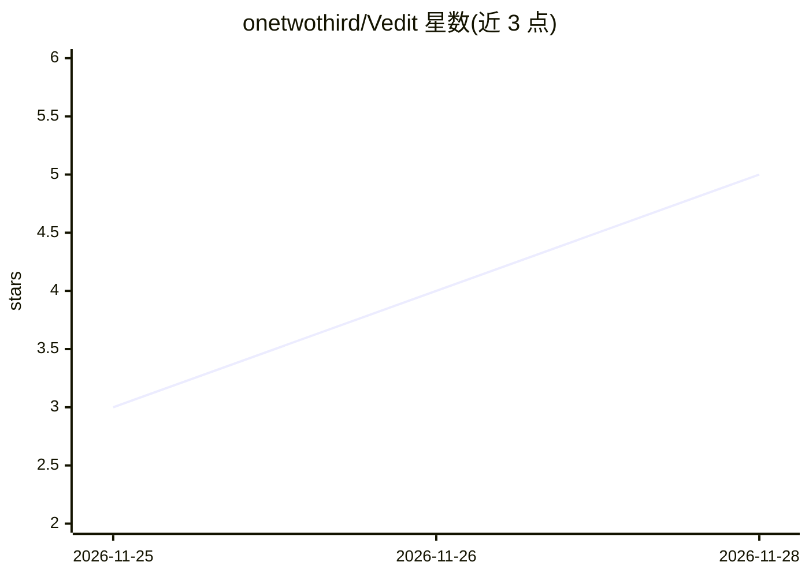

# onetwothird/Vedit

⭐ 5 · Python · MIT · 推送 2026-11-27 · [GitHub](https://github.com/onetwothird/Vedit) · 个人维护

**面向内容创作者的开源 AI 视频剪辑工具**

将口播原始素材自动处理为成片：删除静音、口头语与废条（词级精确切割）、添加逐词动画字幕、人脸感知的多比例导出、响度归一化、生成缩略图与 YouTube 章节。提供三种运行形态：桌面应用 Vedit Studio、命令行工具、Claude Code 技能。所有剪辑以 JSON 格式的 edit decision list 存储，可版本控制。支持照片+脚本生成配音短剧的故事模式，配音可选 edge-tts 免费语音或 OpenAI/ElevenLabs 付费语音。

## 筛选速览

| 维度 | 判定 | 备注 |
|---|---|---|
| AI 角色 | `ai-native` | 本体是模型或模型工具 |
| 许可风险 | `permissive` | MIT |
| 部署形态 | `desktop` | 安装包/桌面程序 |
| 模型依赖 | locked-api |  |
| 硬件要求 | — | 无带数字的原话,不猜 |
| 安装摩擦 | `medium` | 含编译或系统依赖之一 |
| 成熟度 | — | 结构信号不足 |

## 能力要点

- 词级精确的智能切割：去除静音、填充词与废条
- 剪辑以 JSON 格式 EDL 存储，可复查、重复与版本控制
- Claude Code 读取逐词转录与视频帧做编辑决策并渲染成片
- 故事模式：照片加脚本生成多角色配音字幕视频

## 适用场景

- 把长口播录像一键剪成 YouTube/Shorts/TikTok 各平台成片
- 批量处理整个文件夹的原始录像并导出多比例版本
- 用照片和脚本生成带配音与字幕的知识类短 Reels
- 通过对话描述剪辑意图，让 Claude 完成剪辑与渲染

## 场景标签

`语音合成` · 领域:内容生成

## 证据(README 行号)

> L3: **An open-source AI video editor for content creators. Raw footage in, finished video out.**
> L30: - **A Claude Code skill.** Claude reads the word-level transcript, looks at frames from the video, and makes editor
> L41: - **Smart cuts.** Removes dead air, filler words (*um*, *uh*) and flubbed takes, keeping the final take. Cuts are w

## 星数曲线

2026-11-25 3 → 2026-11-28 5（+2）

---
*卡片 v1 · prompt 1.4 · 生成 2026-11-25 · 置信度 high · 依据 README sha `17482afa6801` · [字段定义](../../DATASET.md)*
