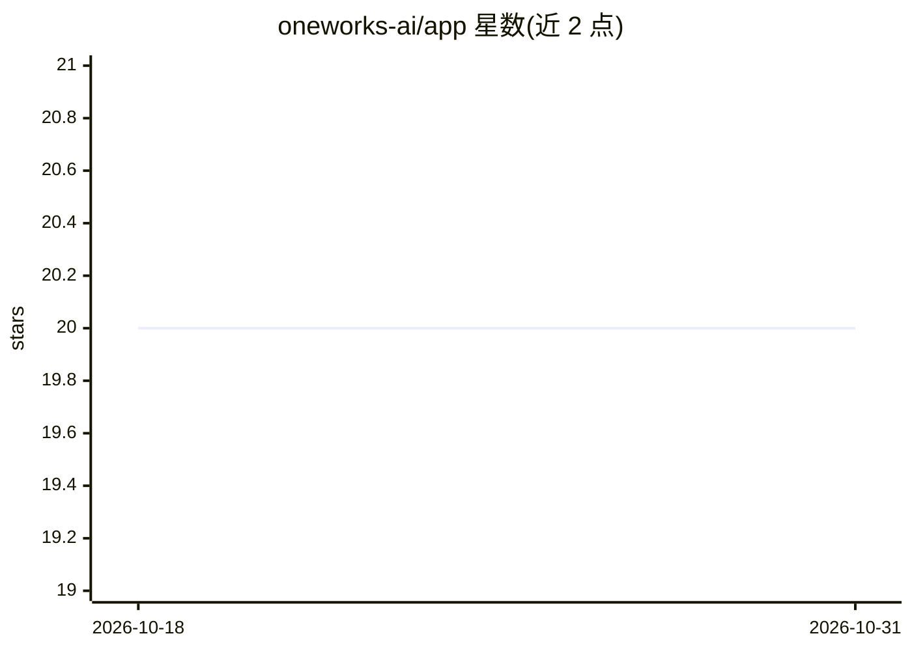

# oneworks-ai/app

⭐ 20 · TypeScript · MIT · 推送 2026-08-30 · [GitHub](https://github.com/oneworks-ai/app) · [官网](https://oneworks.cloud/) · 组织维护 · 中文 README

**统一配置的 AI 工作区：跨桌面/Web/VS Code/CLI 复用同一 AI 工作流**

开源 AI 工作区应用，以可扩展插件与标准化配置系统为核心，将 agents、工具、adapters、会话与本地运行时数据统一在桌面、Web、VS Code 与 CLI 之间，实现一次配置处处使用。仓库为包含 AI agents、插件、桌面端、Web、CLI 与 Relay 的 monorepo。通过 npx oneworks 或 npm 全局安装运行，可启动 Web 界面或直接执行如仓库摘要等命令；Homebrew、Scoop 与桌面安装包由发布自动化生成。

## 筛选速览

| 维度 | 判定 | 备注 |
|---|---|---|
| AI 角色 | `ai-ecosystem` | LLM/agent 周边工具 |
| 许可风险 | `permissive` | MIT |
| 部署形态 | `library` | 以包/库形式分发 |
| 模型依赖 | — | README 未给出锁定关系 |
| 硬件要求 | — | 无带数字的原话,不猜 |
| 安装摩擦 | `low` | 无编译、无系统依赖或容器化 |
| 成熟度 | — | 结构信号不足 |

## 能力要点

- 插件化与标准化配置系统，统一 agents/工具/adapters/会话
- 同一配置跨桌面、Web、VS Code、CLI 使用
- 提供 npx 直接运行与 npm 全局安装两种方式
- monorepo 涵盖 AI agents、插件、桌面端、Web、CLI 与 Relay

## 适用场景

- 在一个工作区内配置并复用多个 AI agent 与适配器
- 在桌面、终端与 VS Code 间保持同一套 AI 工作流
- 用 CLI 快速执行 AI 任务如仓库摘要

## 场景标签

`Agent 框架` · 领域:Agent 开发

## 证据(README 行号)

> L18: One Works is an open-source AI workspace built around extensible plugins and a standardized configuration system. I

## 星数曲线

2026-10-18 20 → 2026-10-31 20（+0）

---
*卡片 v1 · prompt 1.4 · 生成 2026-10-28 · 置信度 mid · 依据 README sha `a3800e2b0b6f` · [字段定义](../../DATASET.md)*
