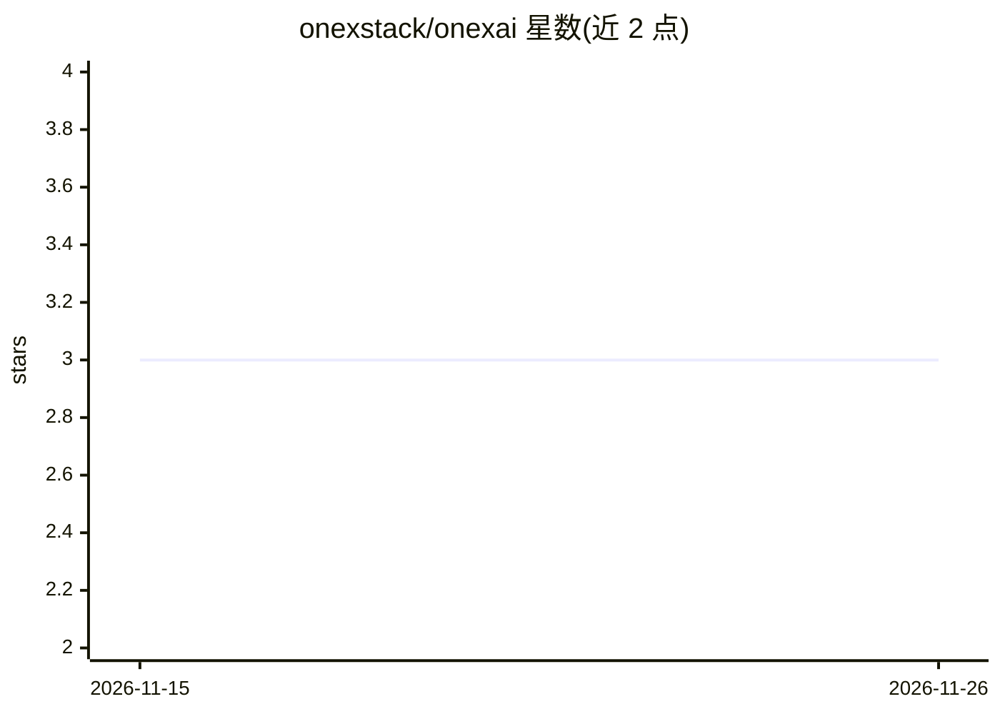

# onexstack/onexai

⭐ 3 · Go · Apache-2.0 · 推送 2026-11-25 · [GitHub](https://github.com/onexstack/onexai) · [官网](https://onex.feizaonet.com/) · 个人维护 · 中文 README

**企业智能体平台：将 Agent 能力与飞书机器人接入企业**

OneX 智能体平台是一个面向企业的智能体平台，包含智能对话、模型/Prompt/Skill/MCP/知识库管理、值班、工单、权限等模块。底层采用声明式架构，基于 ReAct 实现智能体能力，支持通过 Prompt 声明式创建 Agent；内置飞书机器人，可通过 /命令 调用 Agent 与 SKILL。提供 Docker Compose 一键启动、源码构建与 Helm Chart 部署方式，需 PostgreSQL/etcd 等外部组件。以 Go 实现，采用 Apache 2.0 许可证。

## 筛选速览

| 维度 | 判定 | 备注 |
|---|---|---|
| AI 角色 | `ai-ecosystem` | LLM/agent 周边工具 |
| 许可风险 | `permissive` | Apache-2.0 |
| 部署形态 | `self-host` | docker 或自建部署 |
| 模型依赖 | — | README 未给出锁定关系 |
| 硬件要求 | — | 无带数字的原话,不猜 |
| 安装摩擦 | `low` | 无编译、无系统依赖或容器化 |
| 成熟度 | — | 结构信号不足 |

## 能力要点

- 声明式 Agent 创建：通过 Prompt 从平台能力矩阵动态组装智能体
- 内置飞书机器人，支持 /命令、命令调度与飞书卡片渲染
- 基于标准 MCP 协议的 Tool 实现与可插拔能力接入
- 支持 OPA、Casdoor、CMDB 等多种鉴权方式与 Agent 运行时安全机制

## 适用场景

- 企业内部通过飞书 IM 使用智能体完成运维、知识问答等场景
- 统一管理企业内的模型、Prompt、MCP Tool 与知识库
- 对智能对话、服务发布/重启、RCA 等场景做插件化集成
- 通过智能测评挑选效果最好的知识库、SKILL、MCP Tool 组合

## 场景标签

`聊天机器人` `RAG` · 领域:对话与助手

## 证据(README 行号)

> L5: OneX 智能体平台（简称：onexai，也称 OneX AI）是一个企业级的、功能完备的智能体平台，可以帮助企业完成内部的智能化转型。另外，OneX 智能体平台也内置了一个基于飞书的机器人，可以将整个智能化能力接入飞书 IM 应用
> L15: - 完善的智能化能力： OneX 智能体平台具有完善的智能化能力。包含并不限于以下功能模块：智能对话、模型管理、Prompt 管理、Skill 管理、MCP 管理、知识库管理、值班模块管理、工单管理、凭据管理、权限管理等；
> L20: - 基于 ReAct 的 Agentic 架构： OneX 智能体平台底层的智能化能力摒弃了传统的 Dify 工作流，借助于 LLM 的 ReAct 能力实现智能化能力。
> L63: docker compose --env-file env up -d --build

## 星数曲线

2026-11-15 3 → 2026-11-26 3（+0）

---
*卡片 v1 · prompt 1.4 · 生成 2026-11-21 · 置信度 high · 依据 README sha `5fefae8d56d8` · [字段定义](../../DATASET.md)*
