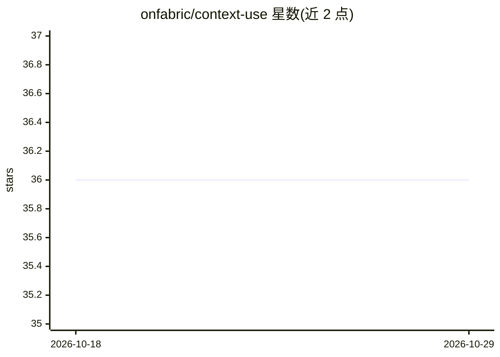

# onfabric/context-use

⭐ 36 · Python · MIT · 推送 2026-04-20 · [GitHub](https://github.com/onfabric/context-use) · [官网](https://context-use.com) · 组织维护

**把对话与数据导出转为可携带 AI 记忆的代理与 CLI 工具**

Python 包 + CLI，提供本地代理：任意 OpenAI 兼容客户端指向代理后，对话自动在后台生成记忆并注入未来请求（仅 /v1/chat/completions 与 /v1/responses 被改写）。支持批量导入 ChatGPT、Claude、Instagram、Google 等 6 家数据导出，经 LLM 实时或批处理 API 生成记忆，存于 SQLite，可语义检索；另有基于全部记忆的多轮 Personal agent（synthesise/profile/ask）。可挂载到自有 ASGI 服务器。

## 筛选速览

| 维度 | 判定 | 备注 |
|---|---|---|
| AI 角色 | `ai-ecosystem` | LLM/agent 周边工具 |
| 许可风险 | `permissive` | MIT |
| 部署形态 | `library` | 以包/库形式分发 |
| 模型依赖 | — | README 未给出锁定关系 |
| 硬件要求 | — | 无带数字的原话,不猜 |
| 安装摩擦 | `low` | 无编译、无系统依赖或容器化 |
| 成熟度 | — | 结构信号不足 |

## 能力要点

- 本地代理自动将对话转为记忆并注入未来请求
- 支持 6 家服务商数据导出的批量导入（实时/批处理两种流水线）
- 记忆存储于 SQLite，支持语义搜索与导出
- Personal agent 可合成高层模式记忆、生成第一人称画像并问答

## 适用场景

- 让任意 OpenAI 兼容客户端自动带上我的历史对话记忆
- 把 ChatGPT/Instagram 等平台的数据导出转成个人记忆库
- 跨会话检索自己的历史对话与行为记录

## 场景标签

`Agent 记忆` `语义搜索` · 领域:Agent 开发

## 证据(README 行号)

> L25: Start the proxy and point any OpenAI-compatible client at it. Every conversation is automatically turned into memor
> L45: Memories are generated in the background from each conversation and are used to automatically enrich future request
> L53: from context_use import ContextUse, ContextProxy, create_proxy_app

## 星数曲线

2026-10-18 36 → 2026-10-29 36（+0）

---
*卡片 v1 · prompt 1.4 · 生成 2026-10-25 · 置信度 high · 依据 README sha `b8fd0f098501` · [字段定义](../../DATASET.md)*
