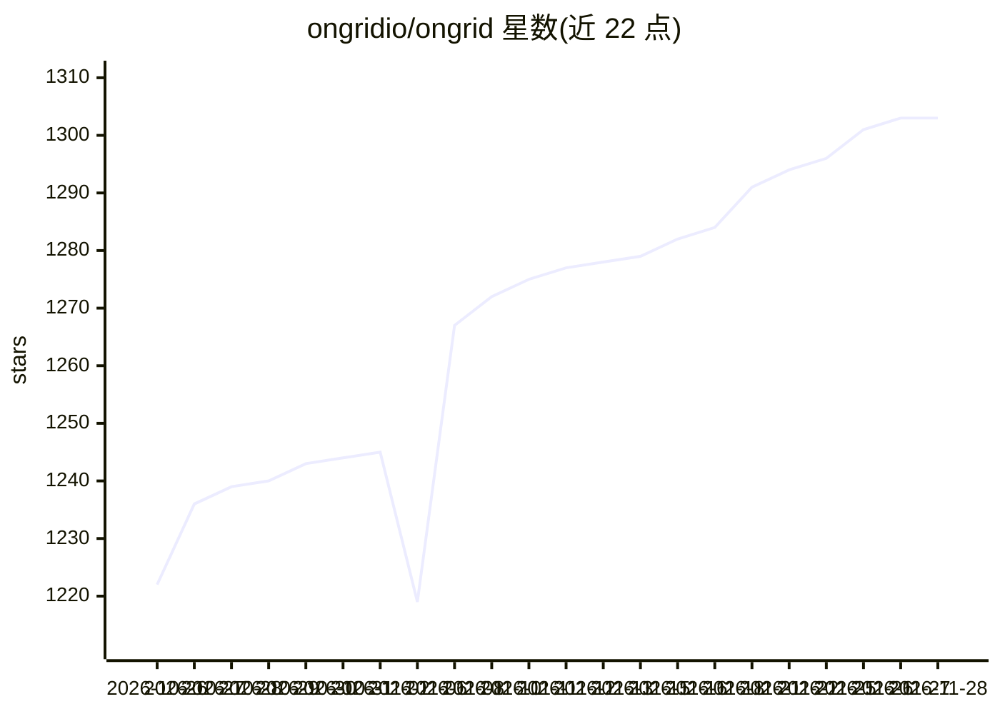

# ongridio/ongrid

⭐ 1,303 · Go · AGPL-3.0 · 推送 2026-11-27 · [GitHub](https://github.com/ongridio/ongrid) · [官网](https://ongrid.cloud) · 组织维护 · 中文 README

**接入 IM 的运维 AI Agent：定位根因并执行修复**

以 Go 编写的自托管运维 AI Agent：从告警或运维提问出发，收集指标、日志、链路、拓扑信息做根因分析并给出证据支撑的结论；协调 Agent 分派给 SRE/网络/DB 专家子 Agent，支持浏览器 SSH、bash 沙箱只读巡检、审批写门禁、工作流编排、知识库索引与 MCP 服务器接入。通过 install.sh 一键部署，经 Slack、Telegram、飞书、钉钉、企业微信双向交互，模型可自选热切换。AGPLv3 许可。

## 筛选速览

| 维度 | 判定 | 备注 |
|---|---|---|
| AI 角色 | `ai-native` | 本体是模型或模型工具 |
| 许可风险 | `viral` | AGPL-3.0 |
| 部署形态 | `None` |  |
| 模型依赖 | locked-api |  |
| 硬件要求 | — | 无带数字的原话,不猜 |
| 安装摩擦 | `low` | 无编译、无系统依赖或容器化 |
| 成熟度 | — | 结构信号不足 |

## 能力要点

- 告警自动触发 RCA 调查并将结论回写到聊天
- 协调者+专家（SRE/网络/DB）多 Agent 架构
- 零入站端口：Edge 反向拨出，浏览器 SSH 与只读巡检工具均留审计
- 内置 Prometheus+Loki+Tempo+Grafana 可观测栈

## 适用场景

- 告警触发后自动调查并回写根因到 Slack/钉钉群
- 运维团队集中管理服务器巡检与 Kubernetes 升级
- 把 runbook 与事故历史索引成人和 Agent 共用的知识库

## 场景标签

`多智能体` `工作流自动化` `RAG` · 领域:Agent 开发

## 证据(README 行号)

> L3: > **An ops AI Agent that understands your infrastructure, finds the root cause, and fixes it — right from Slack or T
> L33: - 🤖 **Coordinator + Specialist agents** — coordinator dispatches to SRE / network / DB sub-agents
> L35: - 🔍 **Root-cause RCA** — walks topology, correlates m/l/t, pins the "why" to a source-code line

## 星数曲线

2026-10-26 1,222 → 2026-11-28 1,303（+81）

---
*卡片 v1 · prompt 1.4 · 生成 2026-11-28 · 置信度 high · 依据 README sha `eb954b52950c` · [字段定义](../../DATASET.md)*
