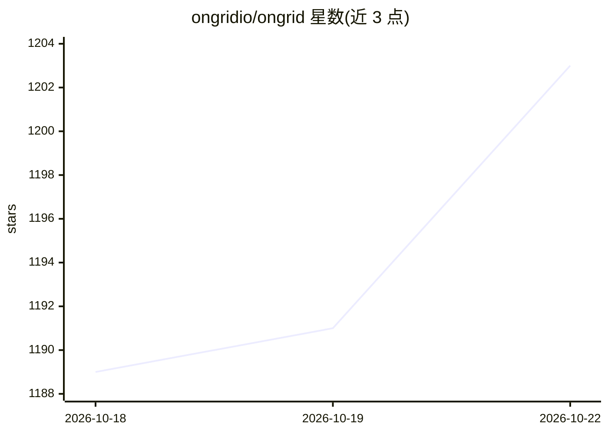

# ongridio/ongrid

⭐ 1,215 · Go · AGPL-3.0 · 推送 2026-10-22 · [GitHub](https://github.com/ongridio/ongrid) · [官网](https://ongrid.cloud) · 组织维护 · 中文 README

**面向运维团队的 AI Agent：从 IM 触发根因分析与修复**

用 Go 编写的自托管运维 AI Agent 平台：通过 Slack/Telegram/Lark/钉钉/企微等 IM 与之交互，coordinator 调度 SRE/网络/数据库等专家子代理，沿拓扑关联指标、日志、追踪定位根因，并可定位到代码行；支持告警触发自动调查、浏览器 SSH（反向隧道，零入站端口）、Kubernetes 生命周期管理与 MCP 服务器注册。可自带模型（Anthropic/OpenAI/GLM/DeepSeek/Gemini/Kimi，热路由）。Linux 二进制包运行 install.sh 一条命令部署，内置 Prometheus/Loki/Tempo/Grafana，AGPLv3 许可。

## 筛选速览

| 维度 | 判定 | 备注 |
|---|---|---|
| AI 角色 | `ai-native` | 本体是模型或模型工具 |
| 许可风险 | `viral` | AGPL-3.0 |
| 部署形态 | `None` |  |
| 模型依赖 | locked-api |  |
| 硬件要求 | — | 无带数字的原话,不猜 |
| 安装摩擦 | `low` | 无编译、无系统依赖或容器化 |
| 成熟度 | — | 结构信号不足 |

## 能力要点

- Coordinator + SRE/网络/DB 专家子代理调度
- 拓扑遍历关联 m/l/t 的根因分析，可定位到源码行
- 零入站端口：Edge 主动外拨，含审计的浏览器 SSH
- 自带模型热路由：Anthropic/OpenAI/GLM/DeepSeek/Gemini/Kimi

## 适用场景

- 告警后自动展开根因调查并把结论写回聊天
- 在 Slack/Telegram/钉钉里让运维 Agent 排查与处置基础设施
- 对生产系统的危险操作设置审批门禁后再执行

## 场景标签

`多智能体` · 领域:Agent 开发

## 证据(README 行号)

> L3: > **An ops AI Agent that understands your infrastructure, finds the root cause, and fixes it — right from Slack or T
> L33: - 🤖 **Coordinator + Specialist agents** — coordinator dispatches to SRE / network / DB sub-agents
> L40: - 🧠 **Bring your own model** — Anthropic / OpenAI / GLM / DeepSeek / Gemini / Kimi, hot routing

## 星数曲线

2026-10-18 1,189 → 2026-10-22 1,203（+14）

---
*卡片 v1 · prompt 1.4 · 生成 2026-10-21 · 置信度 high · 依据 README sha `c022a455d156` · [字段定义](../../DATASET.md)*
