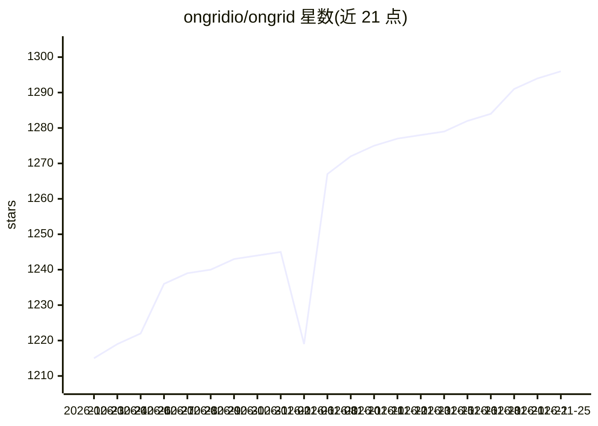

# ongridio/ongrid

⭐ 1,296 · Go · AGPL-3.0 · 推送 2026-11-23 · [GitHub](https://github.com/ongridio/ongrid) · [官网](https://ongrid.cloud) · 组织维护 · 中文 README

**运维 AI Agent：从 IM 里定位故障根因并修复基础设施**

以 Go 编写的自托管运维 AI Agent 平台：接入 Prometheus、Loki、Tempo 等可观测性栈与 Kubernetes 集群，通过 Slack、Telegram、飞书、钉钉等 IM 通道交互；coordinator 调度 SRE/网络/DB 专家子代理，收到告警自动生成 RCA 报告并回写到聊天，具备拓扑爆炸半径分析、浏览器 SSH、26+ 只读巡检工具、审批写入门与知识库索引。模型可自选热切换。通过发布包 install.sh 一键安装，需 Ubuntu 22.04+/Debian 12+/RHEL 9 等服务器环境。

## 筛选速览

| 维度 | 判定 | 备注 |
|---|---|---|
| AI 角色 | `ai-native` | 本体是模型或模型工具 |
| 许可风险 | `viral` | AGPL-3.0 |
| 部署形态 | `None` |  |
| 模型依赖 | locked-api |  |
| 硬件要求 | — | 无带数字的原话,不猜 |
| 安装摩擦 | `low` | 无编译、无系统依赖或容器化 |
| 成熟度 | — | 结构信号不足 |

## 能力要点

- 告警触发自动调查：RCA worker 将根因回写到 IM 通道
- Coordinator + 专家子代理架构（SRE/网络/DB）
- 零入站端口设计：Edge 外拨连接，浏览器 SSH 全程审计
- 自选模型热切换：Anthropic/OpenAI/GLM/DeepSeek/Gemini/Kimi

## 适用场景

- 运维团队在 Slack/钉钉中接收告警后让 Agent 自动排查根因
- 通过对话式聊天查看服务拓扑与爆炸半径
- 将 runbook、事故历史索引成人机共享的知识库
- 对生产变更设置审批门与策略边界

## 场景标签

`多智能体` · 领域:Agent 开发

## 证据(README 行号)

> L3: > **An ops AI Agent that understands your infrastructure, finds the root cause, and fixes it — right from Slack or T
> L33: - 🤖 **Coordinator + Specialist agents** — coordinator dispatches to SRE / network / DB sub-agents
> L40: - 🧠 **Bring your own model** — Anthropic / OpenAI / GLM / DeepSeek / Gemini / Kimi, hot routing

## 星数曲线

2026-10-23 1,215 → 2026-11-25 1,296（+81）

---
*卡片 v1 · prompt 1.4 · 生成 2026-11-24 · 置信度 high · 依据 README sha `e96767892e43` · [字段定义](../../DATASET.md)*
