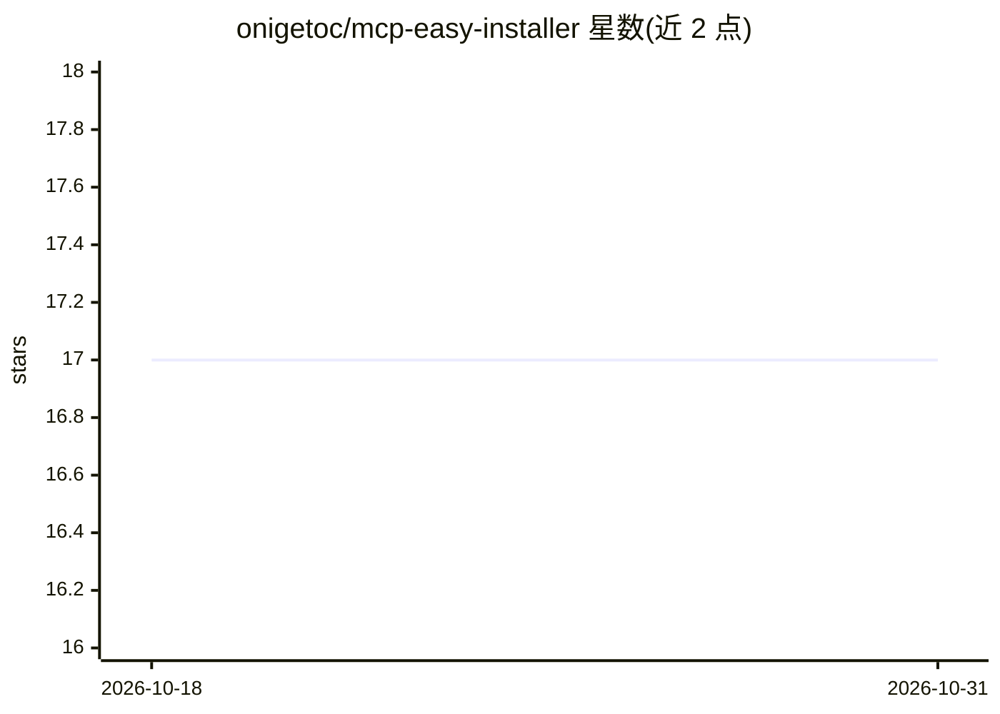

# onigetoc/mcp-easy-installer

⭐ 17 · TypeScript · 推送 2026-07-26 · [GitHub](https://github.com/onigetoc/mcp-easy-installer) · 个人维护

**面向开发者和终端用户的 MCP 服务器安装/修复管理工具**

一个 MCP server，提供搜索、安装、配置、修复和卸载其他 MCP 服务器的工具。不使用 npx，而是手动将 MCP 服务器安装到用户 Documents/Flowvibe/MCP 目录，并自动为 Claude Desktop、Windsurf、Cursor、Roo Code、Cline 等应用维护 JSON 配置。用 TypeScript 编写，跨 Windows/Linux/Mac，但主要在 Windows 上开发测试，Mac/Linux 需社区反馈。GitHub Copilot 不直接支持，Python 集成存在限制。通过 git clone 或下载 release 后 npm install/build 安装。

## 筛选速览

| 维度 | 判定 | 备注 |
|---|---|---|
| AI 角色 | `ai-ecosystem` | LLM/agent 周边工具 |
| 许可风险 | `none` | — |
| 部署形态 | `library` | 以包/库形式分发 |
| 模型依赖 | — | README 未给出锁定关系 |
| 硬件要求 | — | 无带数字的原话,不猜 |
| 安装摩擦 | `low` | 无编译、无系统依赖或容器化 |
| 成熟度 | `idea` | |

## 能力要点

- 搜索、安装、修复、卸载 MCP 服务器的工具集
- 不用 npx，手动安装到固定目录并自动维护各应用 JSON 配置
- 支持 Claude Desktop、Cursor、Windsurf、Roo Code、Cline 等客户端
- TypeScript 编写，跨平台（主要在 Windows 上测试）

## 适用场景

- 我不用命令行也能装好和修好 MCP 服务器
- 批量管理多个 AI 客户端的 MCP 配置
- 排查和修复安装出错的 MCP 服务器

## 场景标签

 · 领域:MCP 生态工具

## 证据(README 行号)

> L3: MCP easy installer is a robust mcp server with tools to search, install, configure, repair and uninstall MCP servers
> L7: MCP easy installer is a robust tool to search, install, configure, repair and uninstall MCP servers (Model Context P

## 星数曲线

2026-10-18 17 → 2026-10-31 17（+0）

---
*卡片 v1 · prompt 1.4 · 生成 2026-10-29 · 置信度 high · 依据 README sha `cd752df92c6d` · [字段定义](../../DATASET.md)*
