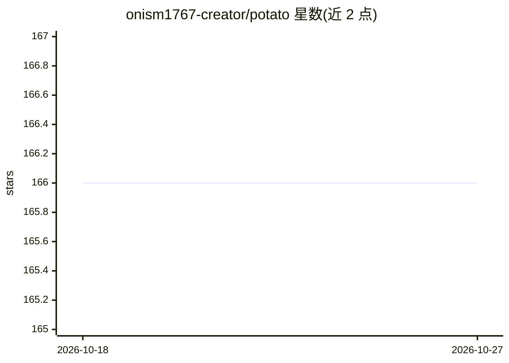

# onism1767-creator/potato

⭐ 166 · Python · MIT · 推送 2026-06-22 · [GitHub](https://github.com/onism1767-creator/potato) · 个人维护 · 中文 README

**测量品牌在 Claude 联网回答中被提及与引用频率的工具**

面向品牌方的 AI 可见度测量工具：向 Claude（带 web search）提问一组冻结的问题（24 题，前 20 题不出现品牌名），收集品牌提及与来源引用，用确定性规则打分，产出带 Wilson 95% 置信区间的单文件离线 HTML 报告，指标含提及覆盖率、引用有效性、自有/第三方引用、份额与稳定性。目前仅接入 Claude，引擎设计为适配器架构、可扩展其他模型。Windows 提供免安装包（内嵌官方 Python），macOS/Linux 用 pip 安装；免费 mock 预览无需 API key，实测需自带 Anthropic key，预算可设上限，全程本地运行。

## 筛选速览

| 维度 | 判定 | 备注 |
|---|---|---|
| AI 角色 | `ai-ecosystem` | LLM/agent 周边工具 |
| 许可风险 | `permissive` | MIT |
| 部署形态 | `desktop` | 安装包/桌面程序 |
| 模型依赖 | locked-api |  |
| 硬件要求 | — | 无带数字的原话,不猜 |
| 安装摩擦 | `low` | 无编译、无系统依赖或容器化 |
| 成熟度 | — | 结构信号不足 |

## 能力要点

- 确定性规则打分，AI 仅用于起草问题与报告叙述，不决定指标
- 三级证据链 mentioned→cited→verified，仅 verified 计入核心分
- 每项指标附 Wilson 95% 置信区间，区间重叠时标注不可区分
- 仅接入 Claude（web search），适配器接口设计支持扩展其他模型

## 适用场景

- 想了解自己品牌在 Claude 联网回答中的提及和引用情况
- 对比多个品牌在 Claude 回答中的可见度份额
- 拿到可复现、可审计的 AI 可见度报告用于汇报

## 场景标签

 · 领域:AI 可见度/品牌监测

## 证据(README 行号)

> L18: Potato measures how visible your brand is **inside Claude's web-search answers**. It asks Claude a fixed set of fro
> L57: - **Deterministic scoring, no AI judge.** Every counted number comes from fixed rules, not a model's opinion. AI is
> L73: Right now Potato connects to **Claude (with web search) only**, so what you see is **your visibility on Claude spec

## 星数曲线

2026-10-18 166 → 2026-10-27 166（+0）

---
*卡片 v1 · prompt 1.4 · 生成 2026-10-22 · 置信度 high · 依据 README sha `4018049bd43f` · [字段定义](../../DATASET.md)*
