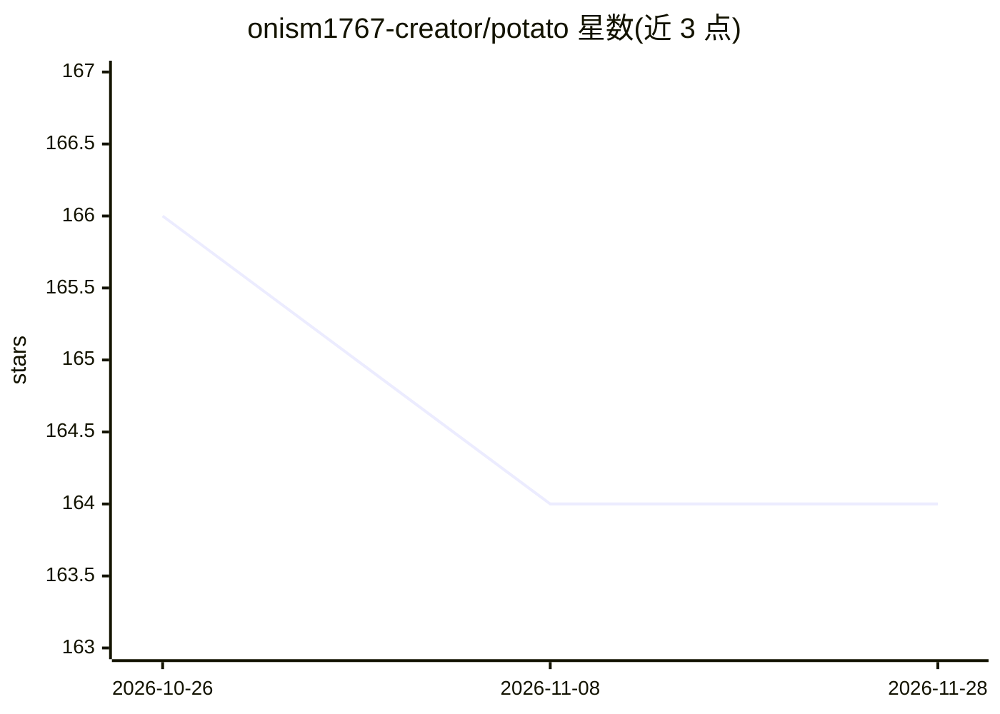

# onism1767-creator/potato

⭐ 164 · Python · MIT · 推送 2026-11-24 · [GitHub](https://github.com/onism1767-creator/potato) · 个人维护 · 中文 README

**测量品牌在 AI 搜索回答中被提及与引用频率的本地工具**

Potato 向 Claude、ChatGPT、Gemini、Perplexity、Grok 等 5 个引擎的 27 个模型发送同一组冻结问题，收集品牌提及与来源引用，用确定性规则（非 AI 评判）打分，生成带 Wilson 95% 置信区间的单引擎 HTML 报告与并排对比，各引擎结果不做合并。证据分 mentioned/cited/verified 三级，默认离线模式不抓取页面。Windows 提供免 Python 的便携包向导，macOS/Linux 开发者可用 pip 安装；免费 mock 预览无需 API key，真实运行需自带各引擎 key 并设每引擎预算上限。

## 筛选速览

| 维度 | 判定 | 备注 |
|---|---|---|
| AI 角色 | `ai-enhanced` | 去掉 AI 部分产品仍成立 |
| 许可风险 | `permissive` | MIT |
| 部署形态 | `desktop` | 安装包/桌面程序 |
| 模型依赖 | locked-api |  |
| 硬件要求 | — | 无带数字的原话,不猜 |
| 安装摩擦 | `low` | 无编译、无系统依赖或容器化 |
| 成熟度 | — | 结构信号不足 |

## 能力要点

- 覆盖 5 个引擎 27 个模型，逐引擎出报告并排对比、不合并分数
- 确定性规则打分，含三级证据链与 Wilson 95% 置信区间
- 免费 mock 预览 $0 无需 key；真实运行设每引擎预算上限与估算
- 100% 本地运行（127.0.0.1），key 仅存内存、不上传数据

## 适用场景

- 测量我的品牌在 Claude/ChatGPT 等 AI 搜索回答中的提及率与引用情况
- 对比不同 AI 引擎对同一品类品牌的呈现差异
- 在真实付费前用 $0 mock 预览报告样式与流程

## 场景标签

 · 领域:品牌监测/AI 可见性分析

## 证据(README 行号)

> L18: Potato measures how visible your brand is **inside AI web-search answers** — **Claude, ChatGPT (OpenAI), Gemini, Pe
> L14: > Potato is a reproducible **proxy measurement** — every result represents **only this engine, under this exact con
> L57: - **Deterministic scoring, no AI judge.** Every counted number comes from fixed rules, not a model's opinion. AI is

## 星数曲线

2026-10-26 166 → 2026-11-28 164（-2）

---
*卡片 v1 · prompt 1.4 · 生成 2026-11-27 · 置信度 high · 依据 README sha `e95aa53a0e1f` · [字段定义](../../DATASET.md)*
