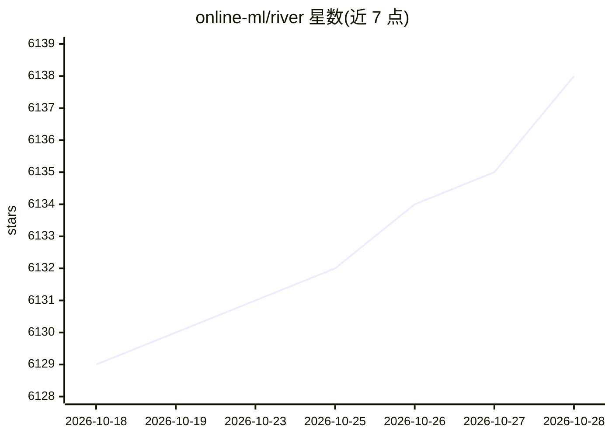

# online-ml/river

⭐ 6,138 · Python · BSD-3-Clause · 推送 2026-10-26 · [GitHub](https://github.com/online-ml/river) · [官网](https://riverml.xyz) · 组织维护

**Python 在线机器学习库：流式数据上逐样本训练与预测**

River 是用于在线机器学习的 Python 库，由 creme 与 scikit-multiflow 合并而来，面向需要在流式数据上做增量学习的场景。核心接口 learn_one/predict_one 逐样本交错预测与更新，不依赖 pandas；mini-batch 接口（learn_many 等）基于 pandas 为可选项。提供线性模型、决策树/随机森林、异常检测、漂移检测、时间序列预测、聚类、Bandit 等算法族，以及特征提取、在线统计、模型管线等工具。需要 Python 3.11+，Linux/macOS/Windows 有预编译 wheel。

## 筛选速览

| 维度 | 判定 | 备注 |
|---|---|---|
| AI 角色 | `ai-native` | 本体是模型或模型工具 |
| 许可风险 | `permissive` | BSD-3-Clause |
| 部署形态 | `library` | 以包/库形式分发 |
| 模型依赖 | — | README 未给出锁定关系 |
| 硬件要求 | — | 无带数字的原话,不猜 |
| 安装摩擦 | `low` | 无编译、无系统依赖或容器化 |
| 成熟度 | — | 结构信号不足 |

## 能力要点

- learn_one/predict_one 逐样本核心接口，无 pandas 依赖
- 覆盖线性模型、树/森林、异常与漂移检测、时序预测、Bandit 等 13 族在线算法
- 提供在线统计、特征提取、内置数据集与模型管线等工具
- Linux/macOS/Windows 均有预编译 wheel

## 适用场景

- 在不回访历史数据的前提下让模型持续学习新数据
- 构建对概念漂移具有鲁棒性的流式模型
- 以事件驱动方式贴近生产环境做在线预测与评估

## 场景标签

 · 领域:机器学习/流式数据

## 证据(README 行号)

> L31:  River is a Python library for online machine learning. It aims to be the most user-friendly library for doing mach
> L82: River provides online implementations of the following family of algorithms:

## 星数曲线

2026-10-18 6,129 → 2026-10-28 6,138（+9）

---
*卡片 v1 · prompt 1.4 · 生成 2026-10-20 · 置信度 high · 依据 README sha `b25c648c201d` · [字段定义](../../DATASET.md)*
