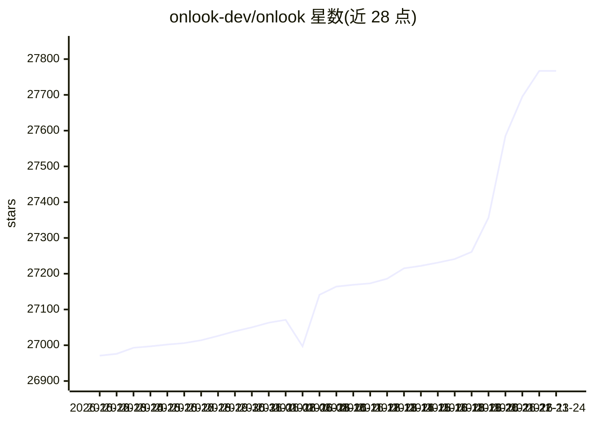

# onlook-dev/onlook

⭐ 27,767 · TypeScript · Apache-2.0 · 推送 2026-11-21 · [GitHub](https://github.com/onlook-dev/onlook) · [官网](https://onlook.com) · 组织维护 · 中文 README

**面向设计师的可视化代码设计工具：在真实代码上用 AI 编辑界面**

本地优先的桌面编辑器（Electron + React），打开本机任意 Git 仓库并运行用户的 dev server，在无限画布上以帧的形式实时呈现应用，支持多端尺寸并排、安全 worktree 副本与多项目标签页。设计改动由用户自行接入的 Claude Code 或 ChatGPT/Codex 账号对应的 agent 执行，编辑真实仓库文件，Git 记录变更；还提供画布外 HTML 草稿、一键 PR，以及导出为自包含 HTML/PNG/JPEG/PDF 的 Artifact。macOS 提供安装包，源码构建目前文档覆盖 Mac。

## 筛选速览

| 维度 | 判定 | 备注 |
|---|---|---|
| AI 角色 | `ai-enhanced` | 去掉 AI 部分产品仍成立 |
| 许可风险 | `permissive` | Apache-2.0 |
| 部署形态 | `None` |  |
| 模型依赖 | — | README 未给出锁定关系 |
| 硬件要求 | — | 无带数字的原话,不猜 |
| 安装摩擦 | `low` | 无编译、无系统依赖或容器化 |
| 成熟度 | — | 结构信号不足 |

## 动量与使用信号

- 维护:`active` — 距上次 push 54.3 天,年发版 0,103 位贡献者
- 涨星:近 1 天 **+13**(自 20261016 起算)

## 能力要点

- 在真实仓库与本地 dev server 上设计，画布实时反映运行中的应用
- 自带模型缺省：接入用户已有的 Claude Code 或 ChatGPT/Codex 账号执行编辑，并支持 MCP 连接器
- 安全 worktree 副本，原文件夹不被改动；一键创建 PR
- Artifact 导出为自包含 HTML、PNG、JPEG、PDF

## 适用场景

- 设计师直接在真实代码库上可视化管理界面样式
- 在画布上通过对话让 agent 修改指定元素或整页布局
- 快速产出 HTML/PNG 原型并分享给同事评审

## 场景标签

`编码 Agent` · 领域:编码与开发

## 证据(README 行号)

> L6:  Onlook is a free, local-first editor where designers craft exceptional experiences in code
> L38: - 🤖 **Bring your own agent.** We don't ship our own model. Connect the Claude Code or ChatGPT/Codex account you alr
> L40: - 🖥️ **A desktop app, local-first.** Onlook runs on your computer. Your code stays on your computer, and the source

## 星数曲线

2026-10-22 26,971 → 2026-11-24 27,767（+796）

---
*卡片 v1 · prompt 1.4 · 生成 2026-11-22 · 置信度 high · 依据 README sha `8bda45bf30f7` · [字段定义](../../DATASET.md)*
